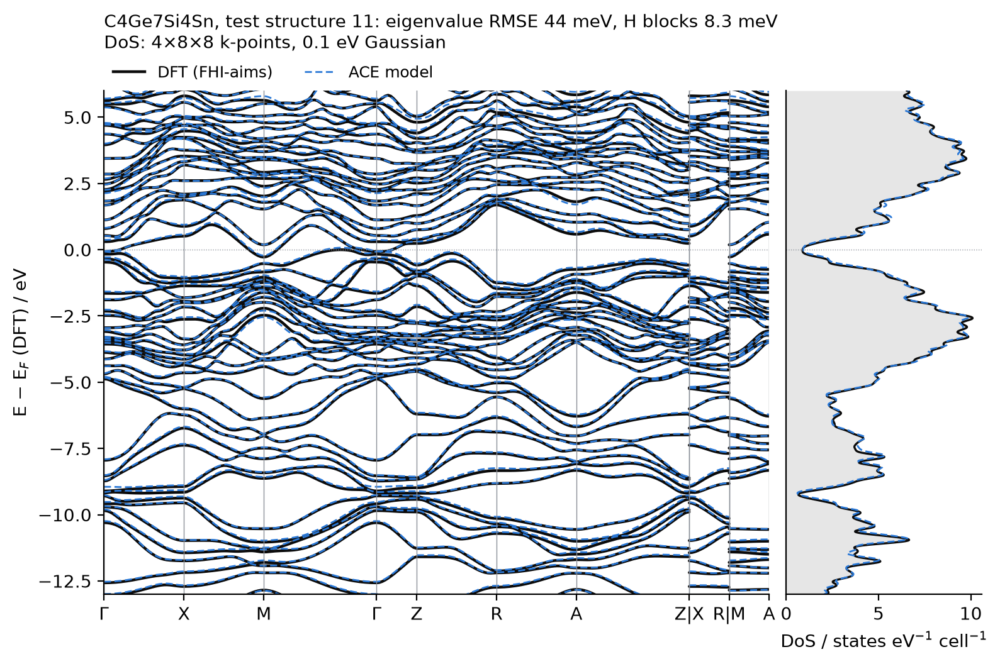

# ACE Hamiltonians: results

Results of `ace_jax.ham` as they are measured. Design: `specs/2026-11-16-hamiltonians-design.md`.

## Conventions on real data (2026-11-16)

- **Orbital order.** Quoll's DeepH output orders a shell as `deeph.DEEPH_ORDER` (positions in m = −l..l), with no sign change relative to ace-jax's real harmonics. Quoll's canonical ("wiki") convention is ace-jax's.
- **How it was fixed.** An overlap is a two-centre integral, so each L part of an overlap shell block is a multiple of Y_L of the bond direction for l₁+l₂+L even, and zero for odd. On Quoll's SiC regression data (s, p, d on C; s, p, d, f on Si) the largest departure is 7.6e-4 over all 2532 blocks (1.5e-3 bound in the test on the 68-block fixture). That is the data's own integration error: the on-site overlap departs from the identity by 2e-3. A wrong order for any single l gives more than 0.05.
- **Units.** eV and angstrom in Quoll's output (the Si 1s on-site energy is −1791.7 eV).
- **Ingestion.** FHI-aims output through `ham/julia/ingest.jl` and `deeph.read` equals Quoll's reference DeepH conversion to 1.4e-14 (H) and 4.4e-16 (S).

## On-site model on the SiC fixture (2026-11-16)

- Basis: order 2, total degree 7, wL = 1, rcut 4 Å, features to L = 6: 280 A functions, 2780 AA products, 564 features over 12 (L, parity).
- The fitted model returns the on-site H and S blocks of all four atoms to 7.8e-9 eV and 3.1e-12. With two equivalent atoms per species this is interpolation: it checks the path on real data, not the accuracy.
- A basis with wL = 1.5 and total degree 5 misses up to 3.7 eV in d–f parts: its only (3, −1) feature is a product of l = 1 and l = 2 functions, which vanish at a tetrahedral site. An orbital basis with f shells needs single-particle functions to l = 3 at least, and features to L = 6.

## On-site timing, first numbers (2026-11-16)

`bench/ham/onsite_time.py 4`: 512-atom rattled SiC, 28 neighbours, the basis above, orbital basis of the fixture (30 orbitals on Si, 23 on C; 175 coefficient vectors for two channels), float64, lestrade (i9-14900K), JAX on the CPU.

| per atom | 32 threads | 1 thread |
|---|---|---|
| neighbour list (host) | 22 µs | 23 µs |
| A and AA (once, for all L) | 30–39 µs | 43 µs |
| A, AA and the features of all 12 (L, parity) | 51 µs | 54 µs |
| on-site H and S, reference readout (a numpy loop over shell pairs) | 209 µs | 148 µs |
| on-site H and S readout alone (compiled), given the features | 5 µs | 10 µs |
| on-site H and S, `OnsitePredictor`, end to end with the neighbour list | 190–225 µs | 93 µs |

- The features of every symmetry cost about 25% on top of the A/AA evaluation an ACE potential already does.
- The compiled readout of all 175 shell-pair parts and both channels costs 5 to 10 µs per atom: one contraction and one sparse scatter per (L, parity).
- **Open.** On one thread the end-to-end time is the sum of its stages (23 + 54 + 10, measured 93 µs). On 32 threads it is 190 to 225 µs, although the stages timed alone take 22, 42 and 5 µs. Fusing features and readout into one compiled program, or `OMP_WAIT_POLICY=passive`, did not change it. Until this is understood, one thread per process is the faster way to run the on-site path, and the off-site model should be timed both ways from the start.

- The comparison with ACEhamiltonians.jl waits for the off-site model, where its cost is.

## On-site speed against ACEhamiltonians.jl (2026-11-16)

Same structure and orbital basis for both codes: 512-atom diamond silicon rattled by 0.05 Å, cutoff 4 Å (15.9 neighbours), the Si basis of Quoll's SiC data (10 shells, s to f, 30 orbitals, 55 shell pairs), correlation order 2, random coefficients, float64, one thread, lestrade (i9-14900K).

- ACEhamiltonians.jl @ 9ff1572 (Julia 1.10, ACE.jl 0.12.22): `bench/ham/aceh_onsite_time.jl`. One sub-model per shell pair; each distinct (l₁, l₂) timed on 32 atoms with the states already built, weighted by its number of shell pairs.
- ace-jax: `bench/ham/onsite_compare.py`. One A/AA evaluation, features of every (L, parity), compiled readout; the end-to-end time includes the neighbour list.

| | size | on-site H, per atom |
|---|---|---|
| ACEhamiltonians.jl, degree 6 | 3163 basis functions over 55 sub-models | 4547 µs |
| ACEhamiltonians.jl, degree 8 | 6821 | 8439 µs |
| ace-jax, total degree 7 (wL = 1) | 2066 coefficients on 134 shared features | 26 µs (neighbour list 13, features 4, readout 5) |
| ace-jax, total degree 9 | 4710 coefficients on 374 shared features | 44 µs (16, 19, 7) |

- **About 100 to 190 times faster** at a comparable number of fitted coefficients (26 against 4547 µs; 44 against 8439 µs). Adding the overlap channel costs ace-jax 11 to 13 µs more (39 and 55 µs for H and S); ACEhamiltonians.jl needs a second model.
- Where it comes from: ACEhamiltonians.jl evaluates 55 separate ACE bases per atom, at 30 to 760 µs each. Here the per-atom work that depends on the environment (A, AA, features) is done once, and half of the 26 µs is the neighbour list.
- **What this does not show.** The two bases are not the same functions (different radials, and a shared feature set against per-block bases), so equal coefficient counts are not equal accuracy. An accuracy-matched comparison needs fits of both codes on the same data, which is planned for the stage-A fitting work. The ACEhamiltonians.jl environment is its last release on current dependencies, not a tuned build.
- On 32 threads ace-jax's stage sums are the same or lower (21 and 49 µs), but the end-to-end time at total degree 9 is 192 µs: the open item above again. At total degree 7 it is 25 µs.

## Accuracy-matched on-site comparison with ACEhamiltonians.jl (2026-11-16)

**Data and protocol** (the ACEhamiltonians paper's own on-site benchmark, arXiv:2111.13736): aluminium, FHI-aims, 729-atom supercells from 500 K MD, 14 orbitals per atom (3 s, 2 p, 1 d shells; 21 shell pairs). Train on the odd-numbered atoms of BCC `SK-supercell-001` and FCC `SK-supercell-002` (730 atoms), the paper's selection; test on every third atom of FCC `SK-supercell-001` and BCC `SK-supercell-002` (486 atoms). Environment cutoff 9 Å (176 neighbours), the paper's value. H blocks divided by 27 (the files hold a 3×3×3 k-sum). Error: RMSE over the elements of the shell pairs s₁ ≤ s₂, in meV (the files are in Hartree; an earlier version of this table printed mHa as meV). Time: one thread, lestrade.

- ace-jax: `bench/ham/onsite_accuracy.py` (reader `bench/ham/aitb.py`; FHI-aims' phases converted with Quoll's table and checked by the overlap's two-centre form, violation 1e-3 on a scale of 27). Least squares, ridge 1e-10.
- ACEhamiltonians.jl @ 9ff1572: `bench/ham/aceh_onsite_accuracy.jl`, same atoms, its own assembly, mean, scaling and LSQR solver (λ = 1e-7), one sub-model per shell pair.

| model | coefficients | test RMSE (meV) | worst block type | model time per atom |
|---|---|---|---|---|
| ACEhamiltonians.jl, order 2, degree 3 | 241 | 268.8 | dd 587.8 | 1198 µs |
| ACEhamiltonians.jl, order 2, degree 4 | 446 | 29.9 | dd 54.2 | 1736 µs |
| ACEhamiltonians.jl, order 2, degree 6 | 1106 | 14.4 | ss 26.7 | 3491 µs |
| ACEhamiltonians.jl, order 1, degree 12 | 322 | 68.6 | dd 114.8 | 10135 µs |
| ace-jax, order 1, 6 radials, l ≤ 4 | 178 | 122.7 | dd 220.7 | 56 µs |
| ace-jax, order 1, 8 radials | 234 | 30.7 | dd 52.8 | 68 µs |
| ace-jax, order 1, 12 radials | 346 | 13.3 | ss 26.4 | 96 µs |
| ace-jax, order 2, (10, 4) radials, l ≤ 4 | 2276 | 15.2 | ss 28.0 | 112 µs |
| ace-jax, order 2, total degree 10, wL = 1 (no caps) | 2210 | 79.7 | dd 206.5 | 143 µs |

Model time is features plus readout for ace-jax and `predict` on prebuilt states for ACEhamiltonians.jl; neither includes the neighbour search (ace-jax: 11.5 µs per atom with matscipy-neighbours, 355 µs with the ASE fallback that the earlier tables used).

- **At matched accuracy ace-jax is 25 times faster at 30 meV (68 against 1736 µs) and 36 times faster at 14 meV (96 against 3491 µs)**, with fewer coefficients (234 against 446; 346 against 1106). With the neighbour search included on ace-jax's side only, 22 and 33 times.
- Both codes reach the same floor, 26 meV in the s–s blocks, whatever the basis.
- **The basis has to be shaped for the problem.** A plain total-degree basis is poor here: 79 meV with 2210 coefficients. The L part of an on-site block is, to leading order, linear in the neighbour density with its own radial profile, so accuracy follows the number of radial functions each l ≤ 4 has at correlation order 1; order-2 terms change nothing on this data (31 meV with and without them at 8 radials). `build_site_basis(nmax_by_order=, lmax_by_order=)` gives that shape. Total degree charges high l with too few radials (5 features for the L = 4 part of d–d at total degree 6, and 20 meV left of a 33 meV signal).
- ACEhamiltonians.jl needs order 2 (order 1 stalls at 68 meV); ace-jax does not. Not understood: it may be its radial basis or its mean handling.
- One dataset, one element, 500 K crystals. Whether order 2 matters for defects, surfaces or liquids is open.
- On 32 threads ace-jax's feature time at this neighbour count is 253 µs against 68 µs on one thread: the open threading item again.

## Inference time of MACE-H, and where ace-jax's on-site model stands (2026-11-16)

**Not yet like for like.** MACE-H (maurergroup/MACE-H @ 3d6248b, arXiv:2508.15108) predicts every block of the Hamiltonian in one forward pass, on-site and off-site. ace-jax has only the on-site model so far. The MACE-H numbers below are the target the off-site model has to be compared with; the ace-jax numbers are the on-site part alone.

**Input.** Quoll's SiC data tiled to a 3×3×3 supercell (108 atoms) and truncated at 7.2 Å, MACE-H's example cutoff: 159 blocks per atom (`bench/ham/tile_deeph.py`). Orbital basis s to f on Si, s to d on C (30 and 23 orbitals).

**MACE-H** (`bench/ham/maceh_time.py`, its own environment: torch 2.4, e3nn 0.6): the network of its example config (3 blocks, correlation 3, hidden 64x0e+64x1o+64x2e, l_max 4, 1.48 M parameters), untrained weights, float32, forward pass plus conversion to blocks as its `eval` does.

| MACE-H | per structure | per atom | per block |
|---|---|---|---|
| CPU, 1 thread (i9-14900K) | 6772 ms | 62.7 ms | 394 µs |
| GPU (RTX 4000 Ada) | 400 ms | 3.7 ms | 23 µs |
| GPU, the 4-atom cell | 49 ms | 12.3 ms | 78 µs |

A 32-thread CPU run did not finish in 48 minutes (one core busy); it was stopped and is not reported.

**ace-jax, on-site H only** (`bench/ham/onsite_time_deeph.py`): the same 108 atoms, environment cutoff 7.2 Å (158 neighbours), order 1 with l ≤ 6, random coefficients, float64, CPU, one thread.

| ace-jax on-site | per atom, polynomial radials | per atom, tabulated radials |
|---|---|---|
| 8 radials per species (112 features, 2375 coefficients) | 558 µs | 247 µs |
| 12 radials (168 features, 3543 coefficients) | 1220 µs | 347 µs |

- With two species and l ≤ 6 the per-neighbour radial stage dominated (543 of 558 µs); the radial tables ace-jax already has for potentials (`eval.model.with_radial_table`, relative error 1.4e-10 here) cut the feature time from 543 to 227 µs. They should be the default for the Hamiltonian carrier.
- What remains is forming and pooling 784 A functions over 158 neighbours per atom; the readout is 2 µs.
- For orientation only: one on-site block costs ace-jax about 0.25 ms on one CPU thread; MACE-H's average cost per block is 0.39 ms on one CPU thread and 0.023 ms on the GPU, for all blocks at once. The off-site model decides the comparison: it has to deliver about 158 off-site blocks per atom, and if each needs its own environment pooling at this cost it will not beat MACE-H's GPU time. That is the argument for sharing the per-atom features across bonds (design option B) and for a GPU run of ace-jax.
- MACE-H's accuracy is not part of this: the weights are untrained, and its model size here is its example's, not one matched to an error.

## Off-site blocks from shared site features: first accuracy (2026-11-16)

The off-site model (`ham/bond.py`, `ham/offsite.py`): for a bond i→j, two-centre functions φ_n(r) Y_L(r̂) plus the bond harmonics coupled with the per-atom features of i and of j, which the on-site model already computes. No environment is pooled per bond. Bond reversal H_ji(−R) = H_ij(R)ᵀ is exact by construction.

**Data.** The aluminium supercells of the ACEhamiltonians paper, all pairs within 9 Å (168 bonds per atom). Train on 20,000 bonds drawn from BCC `SK-supercell-001` and FCC `SK-supercell-002`, test on 10,000 bonds from FCC `SK-supercell-001` and BCC `SK-supercell-002`. Site basis: order 1, 8 radials, l ≤ 4, cutoff 9 Å. 12 two-centre radials. `bench/ham/offsite_accuracy.py`. RMSE over the elements of the canonical blocks; H in meV (converted from the files' Hartree; an earlier version printed mHa as meV), S × 1e3.

| coupled features (radials n_cpl, bond harmonics l ≤ l_cpl) | coefficients per channel | H test (train) | S test | H, d–d | H, bonds < 3.5 Å |
|---|---|---|---|---|---|
| none: two-centre only | 336 | 65.3 (66.4) | 0.0077 | 111.6 | 194.6 |
| 2, l ≤ 2 | 4128 | 46.0 (46.5) | 0.0075 | 86.0 | 91.4 |
| 4, l ≤ 2 | 7920 | 41.1 (41.4) | 0.0073 | 76.2 | 84.1 |
| 4, l ≤ 4 | 13392 | 25.0 (25.6) | 0.0069 | 48.7 | 41.4 |

- The overlap is two-centre and is fitted to 7e-6 by the two-centre functions alone.
- The shared site features carry real environment dependence of H: 65 → 25 meV overall, and 196 → 41 meV for nearest-neighbour bonds. Train and test errors agree, so the limit is the basis, not the amount of data.
- The error is still falling with l_cpl and n_cpl; where it stops, and how that compares with ACEhamiltonians.jl's bond-environment model on the same bonds, is not yet measured. The on-site errors on this data were 14 to 30 meV for comparison.
- Largest single least-squares problem: 652 columns; the fit streams bonds in chunks and takes 37 s.

## Full Hamiltonian inference time against MACE-H (2026-11-16)

Now like for like in what is predicted: every on-site and off-site block of H for the 108-atom SiC input above (159 blocks per atom, cutoff 7.2 Å, s to f orbitals), with untrained weights in both codes. **Not matched in accuracy**: neither model is fitted to this system, and the two model sizes are not known to give the same error.

ace-jax (`bench/ham/offsite_time_deeph.py`): on-site model plus the shared-feature off-site model, compiled (`OnsitePredictor`, `OffsitePredictor`). Site basis order 1, 8 radials per species, l ≤ 6, tabulated radials; 12 two-centre radials. The off-site program contracts the coefficients with the site features once per atom, then does one matrix product per atom over its bonds.

| | per structure | per atom | per block |
|---|---|---|---|
| MACE-H, CPU, 1 thread, float32 | 6772 ms | 62.7 ms | 394 µs |
| ace-jax, CPU, 1 thread, float64, coupled features (2 radials, l ≤ 2) | 1141 ms | 10.6 ms | 67 µs |
| ace-jax, CPU, 1 thread, float64, coupled (4, l ≤ 4) | 1647 ms | 15.3 ms | 96 µs |
| MACE-H, GPU (RTX 4000 Ada), float32 | 400 ms | 3.7 ms | 23 µs |
| ace-jax, GPU, float32, coupled (2, l ≤ 2) | 113–176 ms (5 runs) | 1.05–1.63 ms | 6.6–10.2 µs |
| ace-jax, GPU, float32, coupled (4, l ≤ 2) | 164–168 ms (2 runs) | 1.52–1.56 ms | 9.5–9.8 µs |
| ace-jax, GPU, float32, coupled (4, l ≤ 4) | 148 ms, 831 ms, and one run over 500 s | 1.37 ms, 7.7 ms, – | 8.6 µs, 48 µs, – |

- **CPU, one thread: 4 to 6 times faster than MACE-H.** GPU: 2.3 to 3.5 times faster for the two smaller coupled models.
- **The largest coupled model is erratic on this GPU.** Three runs: 1.37 ms per atom (2.7 times faster than MACE-H), 7.7 ms, and one that did not finish in 500 s. It holds 15 GB of the card's 20 GB (the per-atom coefficient tensors for all atoms at once), so memory pressure is the suspected cause, not confirmed; processing the atoms in chunks is the fix to try.
- On the GPU the time is nearly the same for the two smaller models (113–176 ms) while the on-site program takes 2.5 ms: most of the off-site time is on the host (building the bond list with a Python dictionary for the reverse bonds, and copying 62 MB of blocks back). That is the next thing to remove.
- float64 on this GPU did not finish (its float64 rate is 1/64 of float32); float64 GPU numbers need an A100.
- Three consecutive GPU runs gave 10 to 24 ms per atom while a stray float64 run of mine was still on the GPU; they are excluded.
- Cost by model part: the off-site matrix product does about 100 multiplications per predicted number at (4, l ≤ 4) and 18 at (2, l ≤ 2); the accuracy table above shows what the larger one buys on aluminium (0.92 against 1.69 meV).

## Profile of the full-Hamiltonian prediction on the GPU (2026-11-17)

`bench/ham/offsite_profile.py`: the 108-atom SiC input (158 bonds per atom, s to f orbitals), the small coupled model (2 radials, l ≤ 2; 12 two-centre radials), H only, float32, RTX 4000 Ada.

| stage | where | before | after |
|---|---|---|---|
| site neighbour list | host | 1.0 ms | 1.0 ms |
| site features | device | 2.3 ms | 1.3 ms |
| bond list and reverse-bond index | host | 29.6 ms (a Python dictionary) | 4.8 ms (two sorts) |
| dense (atom, slot) layout | host | 0.2 ms | 0.4 ms |
| off-site blocks | device | 21.5 ms | 20.0 ms (now with the transposed, non-canonical parts) |
| copy the blocks to the host | – | about 190 ms (hidden in the end-to-end time) | 88.5 ms for 192 MB |
| select bonds per species pair, transposes | host | 111.3 ms | 16.9 ms (selection only) |
| end to end | | 354 ms | 123 ms |

- **The model is 21 ms on the device: 0.20 ms per atom, 1.2 µs per block.** With the host-side lists, 27.5 ms (0.25 ms per atom), against MACE-H's 400 ms (3.7 ms per atom) on the same GPU: about 15 times faster if the blocks stay on the device.
- **Two thirds of the remaining end-to-end time is copying the blocks back to the host** (192 MB of float32). A consumer that works on the device (Bloch sums, eigenvalues) does not pay it: `OffsitePredictor.device` returns the blocks there. MACE-H's 400 ms includes its `.cpu()` copy of the same blocks.
- Changes made from the profile: the reverse-bond index by sorting rather than a dictionary, and the non-canonical blocks (transposes of the reverse bond) formed on the device.
- Still wasteful: each ordered species pair is computed on every (atom, slot) and masked afterwards, so a two-species system does about twice the necessary work.

## Positions to eigenvalues on the device (2026-11-17)

`ham/operator.py::HamiltonianPredictor` keeps the predicted blocks on the device, sums them into H(k) and S(k), and solves H(k) c = e S(k) c there (Cholesky of S, then a Hermitian eigensolver). Against a host assembly of the reference predictions and SciPy, the Bloch matrices agree to 1e-11 and the eigenvalues to 1e-9 (`tests/test_ham_operator.py`).

`bench/ham/bands_time.py`, the 108-atom SiC input (2862 orbitals, 158 bonds per atom), H and S, small coupled model, float32, RTX 4000 Ada, one k-point:

| stage | time | share |
|---|---|---|
| blocks of H and S on the device, with the host-side lists | 55.7 ms | 22 % |
| Bloch sum H(k) | 3.2 ms | 1 % |
| Bloch sum S(k) | 3.2 ms | 1 % |
| eigenvalues of a 2862 × 2862 Hermitian matrix, copied to the host | 186.3 ms | 75 % |
| positions to eigenvalues | 248 ms | 2.3 ms per atom |

- The 88 ms copy of the blocks to the host is gone; the only download is the eigenvalues.
- The eigensolver is now three quarters of the time, and it grows as the cube of the orbital count while everything else is linear in the atom count.
- Timed on H(k) alone: with random coefficients the overlap is not positive definite, so the generalised solve (one more Cholesky factor and two triangular solves) is not in this number.
- float32 throughout. Core levels near −1800 eV carry about 0.1 eV of float32 rounding in the eigenvalues; float64 on this card is 1/64 the speed, so an accurate GPU spectrum needs an A100 or a core/valence split.

## Neighbour lists on the device: no host-to-device transfer beyond the inputs (2026-11-17)

`HamiltonianPredictor.prepare_device` builds the site and bond lists on the GPU with matscipy-neighbours' CUDA backend (`eval.nlist.dense_graph(device="cuda")`) and derives everything else there: the image index of each bond, the reverse-bond slot (two sorts), the species masks and the index lists of the Bloch sum.

- **Check.** `tests/test_ham_operator.py::test_device_path_uploads_nothing_but_its_inputs` runs positions → blocks → H(k), S(k) → eigenvalues under `jax.transfer_guard_host_to_device("disallow")` after the compiling call. It passes; the host-list path (`prepare`) raises under the same guard. The uploads that remain are explicit and are the inputs: positions, cell and species (and the neighbour-list library takes the positions itself). One scalar comes down per list (the largest neighbour count, to size the slots).
- **Same result.** H(k) and S(k) from the device lists equal the host-list path's to 1e-10, and every bond finds its reverse.
- **Build.** The PyPI wheels of matscipy-neighbours are CPU-only. On lestrade: a CUDA 12.9 toolchain from conda-forge (`micromamba create -p /storage/eng/essswb/venvs/cuda-build -c conda-forge cuda-nvcc=12.9 cuda-cudart-dev=12.9 cuda-cccl cuda-version=12.9`), then, with its `bin` on `PATH` and `CUDA_HOME` set, `uv pip install --reinstall --no-binary matscipy-neighbours -C cmake.define.ENABLE_CUDA=ON -C cmake.define.CMAKE_CUDA_ARCHITECTURES=89 matscipy-neighbours==1.1.0`. A later `uv sync` puts the CPU wheel back.
- **Time.** No gain at this size: blocks of H and S take 58–60 ms with device lists against 56–67 ms with host lists (108-atom SiC, float32); positions to eigenvalues 251–254 ms either way, three quarters of it the eigensolver. The first version was slower (127 ms) because the slot count doubled from 64 to 256 where 158 are occupied; the lists are now trimmed to the occupied slots in steps of 16. What the device lists buy is a pipeline with nothing large on the host, which matters when the structure changes every call (MD) and for larger systems, not a faster single call here.
- Two things had to be made explicit to pass the guard: the padding vector in `dense_graph` (now an explicit upload) and the trimming slice (compiled, because an eager slice uploads its bounds).

## Eigenvalue error on a held-out aluminium supercell (2026-11-17)

What matters for use is the spectrum, not the blocks. `bench/ham/eigen_accuracy.py`: fit on-site and off-site H and S on BCC `SK-supercell-001` and FCC `SK-supercell-002`, predict the full matrices of FCC `SK-supercell-001` (729 atoms, 10206 orbitals, the Γ point of the supercell), solve H c = e S c and compare with the reference spectrum state by state. Site basis: order 1, 12 radials, l ≤ 4; bond cutoff 9 Å; 20,000 training bonds. Run on mnf148 (the job needs about 12 GB).

| | block RMSE of H inside the cutoff | valence window (E_F − 15 … E_F + 3 eV, 1554 states): MAE / RMSE / max | core (3645 states): MAE / max | all occupied (4739): MAE |
|---|---|---|---|---|
| reference truncated at 9 Å (the floor for this cutoff) | 0 | 0.8 / 1.1 / 3.1 meV | 0.0 / 0.0 meV | 0.12 meV |
| two-centre features only | 55.8 meV | 3954 / 4406 / 43,920 meV | 5.4 / 87 meV | 861 meV |
| with coupled features (4 radials, l ≤ 4) | 20.5 meV | 143 / 188 / 521 meV | 5.5 / 87 meV | 24.9 meV |

- **The model is not accurate enough in the quantity that matters.** A 20 meV block error becomes a 143 meV mean error in the valence eigenvalues, seven times larger; the two-centre model's 56 meV becomes 4 eV.
- The cutoff is not the cause: truncating the reference itself at 9 Å costs 0.8 meV.
- The overlap is not the cause: with the reference S in place of the predicted one the numbers do not change (S is fitted to 5e-6).
- Block errors do not average out in the spectrum. The overlap matrix of this basis has eigenvalues down to 0.03, so the generalised problem amplifies errors of H along nearly dependent orbital combinations, and the errors of the ~180 bonds of an atom are correlated, not independent. A block RMSE is the wrong target for these two reasons.
- Core levels are far better (5 meV): they depend on a few on-site elements.
- ACEhamiltonians.jl's off-site model on the same bonds reaches block errors of 58, 33 and 18 meV at order 1, degrees 4, 6 and 8 (4.1, 14.8 and 39.7 ms per bond), and 51 and 32 meV at order 2, degrees 4 and 6 (11 and 230 ms per bond). Its eigenvalue error is not measured here; at 18–33 meV of block error there is no reason to expect it to be better than the table above.

## Against the 2022 ACEhamiltonians paper: band error on FCC and BCC aluminium (2026-11-17)

**The target** (arXiv:2111.13736, npj Comput. Mater. 2022). Its optimised model (on-site H order 2, degree 9, cutoff 10 Å; off-site H order 1, bond cutoff 10 Å, environment cutoff 5 Å, degrees 9 to 14 per sub-block; overlap order 0, degree 16) gives band structures "with a RMSE of less than 0.4 eV for both phases"; the on-site d–d sub-block has an RMSE of about 10 meV, its largest; the off-site overlap an RMSE of 1e-4. The band error is the paper's `band_error` (its `test/plots.jl`): the RMS over k and over bands 2 to 14 of e·f(e) − e_ref·f(e_ref), f the Fermi function at the DFT Fermi level with σ = 0.086 eV, normalised by all 14 bands; the 1s band is left out. Unoccupied bands therefore count for nothing, and occupied bands count by their full value.

**Same test here** (`bench/ham/band_accuracy.py`): train on the 500 K MD supercells as above; test on the equilibrium FCC and BCC crystals of the paper's `reference_data` (not in the training data, and at lattice constants 4.00 and 3.24 Å, about 1.3 % below the MD cells'), primitive-cell bands along the paper's k-paths from one atom's row of the 9×9×9 supercell matrices.

| ace-jax model (bond cutoff 9 Å, 20,000 training bonds) | FCC, paper's band error | BCC, paper's band error | valence bands to E_F + 10 eV, plain RMSE (FCC / BCC) |
|---|---|---|---|
| reference truncated at 9 Å (floor) | 0.0015 eV | 0.0065 eV | 4.6 / 12.6 meV |
| coupled features (4 radials, l ≤ 4) | **0.219 eV** | **0.711 eV** | 959 / 973 meV |
| paper's optimised model | < 0.4 eV | < 0.4 eV | not given |

- **FCC is inside the paper's target, BCC is not** (0.71 against 0.4 eV).
- The plain RMSE of the valence and low conduction bands is about 1 eV with errors up to 4.8 eV: the unoccupied bands are poor. The paper's metric does not see them; its Fig. 5 claims agreement to 10 eV above the Fermi level, which this model does not have.
- The reference files here are not multiplied by 27, unlike the MD files (their on-site overlap is 1); the script reads the factor from the data.

**What drives the spectrum error** (first-order attribution on the 729-atom MD supercell, `eigen_accuracy.py … diagnose`, valence window, exact MAE 143 meV):

| part of ΔH | block RMSE | first-order eigenvalue MAE |
|---|---|---|
| on-site blocks | 10.5 meV | 5.0 meV |
| off-site, bonds < 3.5 Å | 28.3 meV | 5.8 meV |
| off-site, 3.5–5.5 Å | 43.4 meV | 48.3 meV |
| off-site, 5.5–9 Å | 8.0 meV | 20.5 meV |
| pairs beyond the cutoff | 0.06 meV | 0.9 meV |
| p–d blocks | 10.8 meV | 43.2 meV |
| d–d blocks | 23.0 meV | 28.2 meV |
| p–p blocks | 2.8 meV | 22.1 meV |

- The second and third neighbour shells (3.5–5.5 Å) carry most of the eigenvalue error, and the long-range blocks matter far more than their small block error suggests (8 meV of block error, 20 meV in the eigenvalues): many bonds, coherent errors.
- In the orthonormalised basis ΔH has an RMS element of 47 meV against 10 meV in the orbital basis, and an RMS diagonal of 590 meV. The near-dependence of the basis (overlap eigenvalues down to 0.03) amplifies the error, as suspected.
- First order explains only part: its MAE is 59 meV against the exact 143 meV, and 139 meV of the exact error is a rigid downward shift of the window. The error is not small on the scale of the level spacing of a 10206-orbital supercell.

**Model variants on the paper's metric** (same test; bond cutoff 9 Å and 20,000 training bonds unless said):

| variant | FCC | BCC |
|---|---|---|
| two-centre features only | 2.41 eV | 1.79 eV |
| coupled, 4 radials, l ≤ 4 (the model above) | 0.219 eV | 0.711 eV |
| coupled, 6 radials, l ≤ 4 | 0.235 eV | 0.587 eV |
| coupled, 4 radials; bond cutoff 10 Å, 16 two-centre radials | 0.539 eV | 0.999 eV |
| coupled, 4 radials; 60,000 training bonds | 0.216 eV | 0.801 eV |

No variant reaches 0.4 eV on BCC. More coupled radials help a little, more data does not, and a longer cutoff makes it worse.

**Where the band error comes from** (reference blocks swapped in for one part at a time, reference S):

| H used | FCC: paper's error / plain RMSE to E_F + 10 eV | BCC |
|---|---|---|
| predicted on-site, reference off-site | 0.007 eV / 11 meV | 0.097 eV / 55 meV |
| reference on-site, predicted off-site | 0.219 eV / 965 meV | 0.672 eV / 971 meV |
| predicted only for bonds < 3.5 Å | 0.012 eV / 66 meV | 0.162 eV / 240 meV |
| predicted only for bonds 3.5–5.5 Å | 0.171 eV / 801 meV | 0.233 eV / 872 meV |
| predicted only for bonds > 5.5 Å | 0.157 eV / 303 meV | 0.125 eV / 404 meV |

- **The on-site model is good enough**: with the reference off-site blocks the bands are right to 11 meV (FCC) and 55 meV (BCC).
- **The whole problem is the off-site model, at medium and long range.** Nearest-neighbour bonds are fine in FCC; the second and third shells (3.5–5.5 Å) and the long bonds each cost about as much as the paper's whole budget.
- This is the regime the shared-feature design is weakest in by construction: for a bond longer than a few ångström the environment that matters lies between and around the two atoms, and features centred on each atom separately, summed, do not describe it. ACEhamiltonians' bond-centred cylinder does.

## With the bond-environment group: inside the paper's target (2026-11-17)

`ham/bond.py` now has a fourth feature group, the bond-environment ACE at correlation order 1 (ACEhamiltonians' off-site model): the bond harmonics coupled with A^env = Σ_k w_k R_n(|x_k|) Y_λ(x_k), x_k the position of environment atom k relative to the bond midpoint, w_k a smooth cutoff around each end of the bond. It is the same for a bond and its reverse, so reversal stays exact; the tests check rotation, inversion and reversal with it on.

Same test and metric as the section above (`band_accuracy.py … env=5.0,6,4,4,4`: cutoff 5 Å around each end, 6 environment radials, l ≤ 4, coupled with 4 bond radials and bond harmonics l ≤ 4; the rest as before: coupled site features 4 radials l ≤ 4, bond cutoff 9 Å, 20,000 training bonds; largest least-squares problem 1212 columns, fit 206 s):

| | FCC: paper's band error | BCC | plain RMSE to E_F + 10 eV (FCC / BCC) |
|---|---|---|---|
| paper's optimised model | < 0.4 eV | < 0.4 eV | – |
| shared site features only | 0.219 eV | 0.711 eV | 959 / 973 meV |
| **with the bond-environment group** | **0.021 eV** | **0.107 eV** | **82 / 98 meV** |
| reference on-site, predicted off-site | 0.024 eV | 0.033 eV | 90 / 108 meV |
| predicted on-site, reference off-site | 0.007 eV | 0.097 eV | 11 / 55 meV |

- **Both phases are now well inside the paper's 0.4 eV**: by a factor of about 19 on FCC and 4 on BCC, and the unoccupied bands to 10 eV above the Fermi level are right to about 0.1 eV where they were wrong by 1 eV.
- The off-site error is now spread evenly over bond lengths (each range alone costs 0.015–0.05 eV), no longer concentrated beyond the first shell.
- On BCC the on-site model is now the larger part (0.097 eV with the reference off-site blocks).
- **Not yet measured: the cost.** This group pools an environment per bond, which the shared-feature design avoided; the compiled predictor does not have it yet (`OffsitePredictor` refuses, the reference `OffsiteModel.predict` has it), so there is no timing, and no test of how small the group can be made, or whether the site-coupled groups are still needed beside it.

## Ablation of the off-site feature groups, and what the bond environment costs (2026-11-17)

**Ablation** on the paper's band metric (`band_accuracy.py`; site basis 12 radials, 12 two-centre radials, bond cutoff 9 Å, 20,000 training bonds). `env` = (cutoff around each end, environment radials, environment l_max, bond radials, bond l_max); `site` = coupled site features (radials, bond l_max).

| off-site groups | largest fit, columns | FCC / BCC, paper's band error | plain RMSE to E_F + 10 eV |
|---|---|---|---|
| target (paper) | – | < 0.4 / < 0.4 eV | – |
| site (4, 4) only | 652 | 0.219 / 0.711 | 959 / 973 meV |
| env (5, 6, 4, 4, 4) only | 252 | 0.063 / 0.194 | 205 / 238 meV |
| env (5, 4, 4, 2, 4) only | 92 | 0.340 / 0.312 | 634 / 622 meV |
| env (5, 4, 2, 2, 2) only | 44 | 2.161 / 0.671 | 3241 / 1554 meV |
| env (5, 6, 2, 4, 2) only | 108 | 1.923 / 0.545 | 2517 / 1498 meV |
| env (4, 6, 4, 4, 4) only | 252 | 0.059 / 0.225 | 284 / 428 meV |
| env (6, 6, 4, 4, 4) only | 252 | 0.110 / 0.187 | 210 / 252 meV |
| site (2, 2) + env (5, 6, 4, 4, 4) | 540 | 0.039 / 0.083 | 139 / 145 meV |
| site (4, 4) + env (5, 3, 2, 2, 2) | 996 | 0.158 / 0.195 | 1021 / 326 meV |
| site (4, 4) + env (5, 6, 4, 4, 4) | 1212 | 0.021 / 0.107 | 82 / 98 meV |

- **The bond environment alone meets the target** with 252 columns (0.063 / 0.194 eV), where the site group alone, with 652, does not.
- **It needs harmonics to l = 4** in both the environment and the bond (the d shells): cutting either to l = 2 fails by a wide margin. The number of radial functions matters less (4 environment and 2 bond radials are just inside the target).
- The cutoff around each end is not sensitive between 4 and 6 Å.
- **The site group still helps beside it**: adding the small one (2, 2) roughly halves both errors (0.039 / 0.083 eV), and it is nearly free at inference. That combination is the best trade found.

**Cost** (`offsite_time_deeph.py … env=`; the 108-atom SiC input of the MACE-H comparison, 158 bonds per atom, H only; compiled predictor, which equals the reference predictor to 1e-10 with the group on):

| per atom | CPU, 1 thread, float64 | GPU (RTX 4000 Ada), float32, end to end |
|---|---|---|
| MACE-H | 62.7 ms | 3.7 ms |
| site (2, 2) only (misses the target on BCC) | 10.6 ms | 1.05–1.63 ms |
| env (5, 6, 4, 4, 4) only | 42.0 ms | 0.85 ms |
| site (2, 2) + env (5, 6, 4, 4, 4) | 44.8 ms | 0.88 ms |
| site (4, 4) + env (5, 6, 4, 4, 4) | 60.5 ms | 0.92 ms |

- **On the GPU the accurate model costs nothing extra**: 0.85–0.92 ms per atom, about four times faster than MACE-H, including the copy of the blocks to the host.
- **On one CPU thread the bond environment costs about 34 ms per atom**, four times the rest of the model, and brings the total to 42–60 ms, close to MACE-H's 62.7 ms. The cost is the harmonics and radials of every (bond, environment atom) pair about the bond midpoint: about 9,500 pairs per atom here. This is the pooling per bond that the shared-feature design set out to avoid, and it is where CPU work would have to go (an expansion about each atom translated to the midpoint, or fewer environment atoms per bond).
- Not accuracy-matched with MACE-H (untrained there), and the accuracy numbers are for aluminium while the timings are for the SiC input; the feature sizes are the same.

## CPU cost of the bond environment: where it goes (2026-11-17)

CPU inference is a requirement (coupling to DFT codes for SCF injection), so the 34 ms per atom the environment group adds on one thread was profiled (108-atom SiC, one thread, float64):

| piece | per atom |
|---|---|
| pooling the environment about each bond's midpoint (harmonics and radials of 7,268 pairs) | 1.2 ms |
| building the coupled features φ_n (Y_l ⊗ A^env_λ)^L, all 13 symmetries | 7.1 ms |
| one matrix product per symmetry with the coefficients (17 GFLOP/s, as fast as BLAS) | about 6 ms |
| **one species pair, total added by the environment** | **about 14 ms** |
| the same for SiC as the code stands: three species pairs, each on every (atom, slot) | about 34 ms |

- The pooling per bond, which I expected to be the cost, is small. Two attempts that did not help: one atom at a time instead of all atoms at once (cache), and one matrix product per symmetry instead of a contraction per group.
- **Most of the two-species cost is waste**: each canonical species pair is evaluated on every (atom, slot) and masked afterwards, although a bond belongs to exactly one pair. With the same geometry declared as one species the full prediction takes 20.1 ms per atom with the environment and 6.1 ms without, against 44.8 and 10.6 ms for SiC.

| full H, one CPU thread, per atom | without environment | with environment (5, 6, 4, 4, 4) + site (2, 2) |
|---|---|---|
| MACE-H | 62.7 ms | – |
| SiC geometry as one species (no waste) | 6.1 ms | 20.1 ms |
| SiC, two species, as the code stands | 10.6 ms | 44.8 ms |

- Next: dense layouts per ordered species pair (rows of one species, slots of the other), so each bond is evaluated once. Expected to bring two-species systems to about the one-species figure, three times faster than MACE-H on one thread at the accuracy that meets the paper's target.
- After that the per-bond cost is set by the number of environment features per predicted number (240 to 360 here); fewer radials (the ablation's 4 and 2, just inside the target) cut it roughly in proportion.
- Still open from earlier: more CPU threads do not help and sometimes hurt. For a DFT code running on many cores this matters as much as the single-thread time.

## One dense layout per ordered species pair (2026-11-17)

The compiled off-site predictor now takes one dense layout per ordered species pair (rows: the atoms of the first species; slots: their bonds to the second), on the host-list path (`offsite_fast.PairLayouts`) and the device-list path (a stable sort per row packs each pair's neighbours; one small array of slot counts comes down to the host). Each bond is evaluated once, in the layout of its canonical pair; the other orientation is that block transposed. Before, every canonical pair was evaluated on every (atom, slot) and masked.

| full H, 108-atom SiC, per atom | before | now | MACE-H |
|---|---|---|---|
| CPU, 1 thread, float64: site (2, 2) only | 10.6 ms | 5.0 ms | 62.7 ms |
| CPU, 1 thread: env (5, 6, 4, 4, 4) only | 42.0 ms | 13.0 ms | |
| CPU, 1 thread: site (2, 2) + env (5, 6, 4, 4, 4) | 44.8 ms | 14.2 ms | |
| GPU (RTX 4000 Ada), float32: site (2, 2) only | 1.05–1.63 ms | 0.31 ms | 3.7 ms |
| GPU, float32: site (2, 2) + env | 0.88 ms | 0.94 ms | |

- **CPU, one thread, with the model that meets the paper's target: 14.2 ms per atom, 4.4 times faster than MACE-H.** Better than the one-species estimate (20 ms), because a mixed pair is evaluated in one orientation only.
- The GPU time with the environment did not change: there the environment contraction runs one atom at a time (`lax.map`, chosen for the CPU cache), which is sequential on a GPU. Not pursued (CPU is the requirement).

**Correction: which core (2026-11-17).** lestrade's i9-14900K has 8 performance cores (logical CPUs 0–15) and 16 efficiency cores (16–31). The one-thread ace-jax rows of the two tables above, and of the ablation and profile sections, were pinned to CPU 20, an efficiency core; MACE-H's 62.7 ms was not pinned. Both codes pinned to the same core (`taskset -c 4` and `-c 20`; full H, 108-atom SiC, one thread; ace-jax float64, MACE-H float32):

| per atom | performance core | efficiency core |
|---|---|---|
| MACE-H | 54.1 ms | 118.2 ms |
| ace-jax, site (2, 2) only | 2.1 ms | 5.0 ms |
| ace-jax, env (5, 6, 4, 4, 4) only | 4.6 ms | 13.0 ms |
| ace-jax, site (2, 2) + env (5, 6, 4, 4, 4) (meets the paper's target) | 5.0 ms | 14.2 ms |

- **Like for like, the model that meets the paper's target is 10.7 times faster than MACE-H on a performance core and 8.3 times on an efficiency core.** The ratios between ace-jax configurations in the earlier tables stand; their absolute times are the efficiency core's.

## CPU threads (2026-11-17)

XLA's own CPU threading gives this program little: 1.65 times on 16 cores (mnf148, 2 x 16-core Xeon Gold 6130, idle), and on lestrade it was sometimes slower than one thread. Independent compiled calls from Python threads do scale (they release the GIL): 16 concurrent calls gave 15 times the one-core throughput.

`OffsitePredictor(model, threads=T)` / `HamiltonianPredictor(onsite, offsite, threads=T)` (CPU backend only; default 1) evaluates the rows of every species-pair layout in chunks on a pool of T threads, in passes whose chunks are each complete in themselves: (1) the bond geometry of every layout and the second-atom part on the reverse layouts; (2) the canonical blocks, reading pass 1 through the reverse index; (3) for `dense`, the per-bond output gathered (and, for the other orientation, transposed) in chunks of bonds; for `prepare`, the other orientation's layout. A test holds the result to the single call's at 1e-12.

Full H, 108-atom SiC, site (2, 2) + env (5, 6, 4, 4, 4), float64, mnf148 (`HAM_THREADS=T taskset -c 0-(T-1) offsite_time_deeph.py`):

| threads | XLA threading only | chunks on a thread pool | speed-up |
|---|---|---|---|
| 1 | 19.0 ms per atom | 18.8 ms | 1.0 |
| 2 | 15.4 | 10.8 | 1.7 |
| 4 | 13.5 | 6.3 | 3.0 |
| 8 | 11.6 | 3.6 | 5.2 |
| 16 | 11.5 | 2.7 | 7.0 |
| 32 (both sockets) | – | 2.6 | 7.2 |

- The off-site part alone scales 8.1 times on 16 threads. What is left serial: the site features and on-site blocks (45 ms of 289 at 16 threads, still on XLA's threading), the host neighbour and bond lists (about 15 ms), and memory traffic of the 96 MB of blocks.
- At 32 threads a chunk is two atoms of this 108-atom cell; larger structures should scale further. Not measured.
- lestrade, 8 performance cores, with two unrelated jobs running on two of them: 5.1 ms (1 thread) to 1.4 ms per atom (8 threads).
- For a DFT code that runs one MPI rank per core, the one-thread figure is the relevant one, and each rank can call the predictor for its own atoms; that interface is not built.

## Collinear spin: data and ingestion (2026-11-17)

**FHI-aims.** Version 261002, built on the SCRTP nodes with GCC 14.3, OpenMPI 5.0.8, FlexiBLAS/OpenBLAS and ScaLAPACK 2.2.2 (`module load foss/2025b`; CMake with Unix Makefiles: Ninja refuses the source, two rules generate `full_rel_gw_types.mod`; no HDF5, so `output_rs_matrices plain`). Not in this repository (licensed); the build is under `/storage/eng/essswb/projects/ace-jax/ham-ref/fhi-aims/`.

**Dataset** (`ham-ref/fe_spin/`: `make_structures.py`, `control.head`, `run_all.sh`, `ingest_all.sh`): bcc Fe, 2 x 2 x 2 conventional cells (16 atoms), a = 2.83 Å, positions rattled by 0.05, 0.1 or 0.15 Å, every second cell strained by up to 3 %; 40 structures. PBE, light species defaults (31 orbitals per atom: 5 s, 3 p, 2 d, 1 f shells), atomic ZORA, `spin collinear` with initial moments 2.5, Gaussian smearing 0.1 eV, 6 x 6 x 6 k-points, `sc_accuracy_rho 1e-5`. 70 to 100 SCF cycles and 7 to 10 minutes each on 32 cores (default Pulay mixing; a mixing parameter of 0.2 instead of 0.05 was no faster). Moments 1.9 to 2.2 µ_B per atom. Blocks reach 9 Å (328 per atom; beyond that below 1e-8 eV).

**Ingestion.** Quoll reads `rs_hamiltonian_up.out` / `_dn.out` (`FHIaimsCSCSpinRealMetadata`) but has no conversion of those operators to its canonical form (`convert_spins_source` has no FHI-aims method). Each spin channel's file has the layout of a spin-free Hamiltonian, so `ham/julia/ingest.jl fhi-aims-spin` sends each through the spin-free path from a directory of links and writes `<out>/up` (H, S) and `<out>/dn` (H); `deeph.read_spin` returns one `OperatorData` with the channels `("H_up", "H_dn", "S")`, which the cache, both fits and the predictors take as they are (`bands(..., channel=)` selects the spin).

**Check** (`bench/ham/spin_check.py`, on the 16-atom and the 2-atom calculation): the eigenvalues of each ingested channel with the overlap equal the ones FHI-aims lists for its first k-point to 5e-6 eV (its print precision), all 296 (37) listed states of both spins; the electron count on the calculation's k-grid at its chemical potential is 416.00000 (52.00000). The moment from the same sum is 34.340 where FHI-aims prints 34.264 (0.2 %): not understood, and not an ingestion error given the eigenvalues.

**Fixture** `fixtures/ham/fe_spin_deeph` (2-atom distorted bcc cell, blocks to 3 Å, three files of 30 blocks) and `tests/test_ham_spin.py`: the reader, its refusal of two different structures, the cache, a three-channel fit and the bands of each spin channel.

## Collinear spin: first fit, 12 structures (2026-11-17)

`bench/ham/spin_fit.py <npz dir> 2 3000`: one on-site and one off-site model with the channels (H_up, H_dn, S); site basis 12 radials, site group (2, 2), bond environment (5, 6, 4, 4, 4), bond cutoff 9 Å; 12 training structures (3,000 bonds of each), 2 test structures; fitted in 296 s.

| test blocks | RMSE | largest |
|---|---|---|
| H_up, H_dn on-site | 6.2, 6.9 meV | 88, 148 meV |
| H_up, H_dn off-site | 5.1, 5.1 meV | 319 meV |
| S on-site, off-site | 0.006, 0.013 meV | 0.1, 0.5 meV |

| eigenvalues, E_F − 12 to E_F + 5 eV, both spins, 4 x 4 x 4 k-points, predicted H with the reference S | RMSE | largest | E_F error | moment per atom, mean error |
|---|---|---|---|---|
| full generalised eigenproblem | 5326 meV | 48.8 eV | 333 meV | −0.10 µ_B |
| in the span of S(k) eigenvectors above 1e-3 | 21.8 meV | 108 meV | 3.5 meV | −0.014 µ_B |
| above 1e-2 | 21.3 meV | 94 meV | 2.4 meV | −0.013 µ_B |
| above 1e-1 | 21.8 meV | 98 meV | 1.7 meV | −0.012 µ_B |

- **The light Fe basis is nearly linearly dependent**: the smallest eigenvalue of S(k) is 1.8e-4. A 5 meV error in H in such a direction is a spurious state anywhere in the spectrum, and the full eigenproblem of the predicted H is useless although its blocks are good. Aluminium's minimal basis did not show this.
- Solving in the well-conditioned part of the overlap (canonical orthogonalisation, as DFT codes do with a much smaller threshold) removes the spurious states: 22 meV RMSE, and the moment to 0.014 µ_B per atom (reference 2.10 to 2.14).
- That subspace is itself an approximation: the reference's own eigenvalues move by 19 meV RMSE (171 meV at most) at 1e-3 and by 118 meV at 1e-1. So the threshold trades a known projection error for robustness; the alternative is a fit that weights the error in the metric of S^(-1/2) (a spectral loss), which the design lists as later work.
- With the predicted S instead of the reference S the numbers are the same to 1 % (S is predicted to 0.01 meV).
- For SCF injection only the blocks matter (the DFT code solves its own eigenproblem with its own basis threshold), so this concerns direct use of the predicted bands.
- Prediction: 99 to 123 ms per atom for this call (8 threads, including compilation; 31 orbitals and 328 bonds per atom, three channels). Not yet timed properly.

## Onto the package structure of #168 and #169 (2026-11-17)

`main` merged (conflict-free). Then, on this branch (step 6 of `docs/dev/specs/2026-11-17-package-structure-design.md`, done here before the branch merges, by the owner's decision):

- `basis/cg.py` (from `ham/cg.py`), a framework module.
- `ace_jax.operators` (orbitals, data, features, bond, onsite, offsite, offsite_fast, fit) and `ace_jax.ham` (deeph, cache, operator): moves only.
- The block fit on `fit.linear`: one design per (species [pair], L, parity[, same shell]) with every shell pair and channel as a right-hand side, streamed with `host_qr_stream`, solved with `posterior_qr`; `stats=True` returns `Factor`s. Same coefficients as before (the 12-structure Fe fit reproduces every number above); the fit time is unchanged (285 s against 296 s), because it is the NumPy feature construction per chunk of bonds, not the QR.
- Still to do, after #170: the site features on `eval.features` / `eval.product` without the carrier `ACEModel` (the two edges in the layer test's allow-list), and the element-embedding (TrACE) provider.

## Feature providers after #170 (2026-11-17)

- `operators/features.py::SiteBasis` is an `eval.features.SiteFeatures` provider with no model inside: a `TensorRadial` built from `basis.radial_init`, `eval.features.pooled_a` and `eval.product.product_basis`. Its features are bitwise those of the carrier-`ACEModel` form (two bases, 400 random edges: difference 0.0). `basis/model.py` is `main`'s file again and the layer test's allow-list is empty.
- `with_table()` replaces `with_radial_table(carrier)`: a cubic B-spline in r per species pair with the radial's own end curvatures; features agree to 3e-14 relative at 4,096 intervals for r from 1.2 Å. Timing unchanged (5.0 ms per atom, one performance core, back to back with the previous commit).
- `build_embedding_site_basis`: the element-embedding (TrACE) provider on `build_embedding_model`'s one-particle basis (one Jacobi spline table and a frozen embedding row for the neighbour species; channel-diagonal bodies). Tests: rotation and inversion of every feature with five elements through two channels at order 2; with the identity embedding at order 1 the features are the categorical ones (additive over elements, each element in its own channel). Five elements through two channels give as many features as two elements.
- Not yet species-aware: the bond-environment group pools the environment atoms without their species, and the two-centre and coupled groups still have coefficients per species pair. A many-species benchmark needs the embedding in the environment group too.

## Cross-code benchmark: plan and first findings (2026-11-17)

**Aim** (owner): Pareto fronts of accuracy against inference cost against training-set size for ace-jax, ACEhamiltonians.jl, MACE-H and DeepH, analogous to the Si benchmark for potentials. Accuracy is an eigenvalue error, not a matrix-element error. Primary dataset: the MACE-H paper's bulk gold. Later: the MACE-H paper's other benchmarks, and a system with more species than ACEhamiltonians.jl can take (needs the element embedding in the bond-environment group).

**Bulk gold** (Zenodo 10.5281/zenodo.15223696, arXiv:2508.15108; in `ham-ref/maceh-zenodo/`): 200 FCC cells of 64 atoms from 1000 K EMT molecular dynamics (farthest-point sampled), FHI-aims PBE, **no spin-orbit coupling** (`isspinful: false`, real blocks; the config files are only named `Au_soc`), core states projected out: 9 orbitals per atom (s, p, d), blocks to 10 Å (227 per atom), DeepH layout. 190 train (the authors split 4:1 into training and validation), 10 test. Metrics: MAE of the H matrix elements; EE(T) = Σ |ε − ε̃| f(ε, μ, T) / Σ f on 7 x 7 x 7 k-points at 1000 K, 11 electrons per atom, with the reference overlap.

| published, gold test set | H MAE | EE, average |
|---|---|---|
| MACE-H (pristine; 0.269 meV with shift-and-scale) | 0.316 meV | 2.96 meV |
| DeepH-E3 | 0.409 meV | 6.28 meV |

MACE-H inference there: 10 s per configuration on 8 threads of an EPYC 7742 (about 156 ms per atom).

**ace-jax, first runs** (`bench/ham/deeph_fit.py <gold dir> <n_train> 11`; site basis 12 radials to 7 Å, 12 bond radials, site group (2, 2), environment (5, 6, 4, 4, 4), H only, 540 columns at most; lestrade):

| training structures | fit | H MAE | H RMSE | EE absolute / relative to each μ | prediction, 8 threads |
|---|---|---|---|---|---|
| 1 (all 14,556 bonds) | 23 s | 0.360 meV | 0.834 meV | 4.17 / 2.47 meV | 1.3 ms per atom |
| 4 (3,000 bonds each; 2 test structures) | 16 s | 0.371 meV | 0.838 meV | 4.71 / 2.47 meV | 1.3 ms per atom |
| 16 (all bonds) | 233 s | 0.349 meV | 0.788 meV | 4.57 / 2.44 meV | 1.1 ms per atom |

- One training structure and 23 s already give the matrix-element error of the published networks trained on 152. The error does not fall with more data: this model is at its capacity, so the next step is a larger basis, not more data.
- **EE convention: relative to each chemical potential** (`MACE-H/inference_tools/new_version/Band.py::compute_eigenvalue_error`), so the comparable ace-jax figure is the second one: **2.47 meV with one training structure, 2.44 with 16, against 2.96 (MACE-H) and 6.28 (DeepH-E3)**.
- The largest error is 70 meV: a few elements are far worse than the mean.

**The other codes on gold** (probes on moriarty's RTX A4500, 20 GB; `bench/ham/maceh_train.py`, which now also drives DeepH-E3):

- MACE-H with its authors' gold settings trains: 4.9 s per epoch for 8 structures at batch size 2. The published recipe (152 structures, 2,500 epochs) is then about 65 GPU-hours on this card; a ladder of training-set sizes from 1 to 152 about 120.
- DeepH-E3 (`Xiaoxun-Gong/DeepH-E3`, MIT) runs in MACE-H's environment unchanged (torch 2.4, e3nn 0.6) with the same data folders and config files: 5.0 s per epoch for 8 structures at batch size 1 (batch size 2 does not fit 20 GB with its default network). The paper already gives its gold numbers.
- The aluminium cells of the 2022 paper (729 atoms, 130,000 bonds each) do not fit MACE-H on 20 GB at any width tried; a 64-atom aluminium set with that paper's FHI-aims settings is being computed (`ham-ref/al_small/`) as the link to it.

**DeepH variants** (survey):

| variant | what it is | code | viable here |
|---|---|---|---|
| DeepH (2022) | local coordinates, not equivariant layers | `mzjb/DeepH-pack`, LGPL; torch 1.9, PyG 1.7 | probably, in its own old environment; superseded |
| DeepH-E3 (2023) | E(3)-equivariant; MACE-H's starting point | open, MIT | yes: runs now |
| DeepH-2 (2024) | eSCN (SO(2)) convolutions, transformer | no standalone repository found | only through the new DeepH-pack |
| DeepH-pack 1.0 "deepx" (arXiv:2601.02938, January 2026) | the group's rewrite in JAX/FLAX that consolidates the methods; "light" wheel | GPL-3; the wheel is obtained by applying on the DeepH-pack website; Python 3.13, CUDA 12.8 | needs the owner to apply; the one most likely to be fast, and the current reference |
| xDeepH | magnetic systems | `mzjb/xDeepH`, on DeepH-E3 | relevant to the Fe spin data, later |
| DeepH-hybrid, -Zero, -DFPT, HPRO | other targets (hybrid functionals, unsupervised, perturbation theory, plane waves) | – | not for this comparison |
| DeepH-UMM | universal pretrained model | OpenMX bases | no: another basis |

Plan: DeepH-E3 first (it runs, and has published gold numbers), DeepH-pack 1.0 if a wheel can be obtained, the 2022 DeepH only if it is wanted for completeness.

## Species in the bond-environment group (2026-11-17)

The environment about the bond midpoint now has species channels: A^env_(c n' λ) = Σ_k w_k emb[z_k, c] R_n'(|x_k|) Y_λ(x_k). `emb` is the identity by default (one channel per element of the site basis) or `BondBasis.env_emb`, an (elements, channels) embedding, so that the number of environment features follows the channel width. One element is one channel, and the gold result is unchanged to the digit (0.375 meV, 2.83 meV on the same test structure). `env_lists` returns the neighbours' species as a third array (`numbers=`), on the host and on the device path.

Tests (`test_operators_bond.py`, `test_operators_offsite.py`): on a random two-element structure the environment features of a bond change when two atoms away from it swap species, and do not with a one-channel embedding of equal weights; the channels sum to the species-blind features and any embedding is a linear combination of them; rotation, inversion and bond reversal as before; on the SiC fixture the compiled predictor (one call, and threads) equals the reference with the group on, and the fit is no worse than the blind group's (in that perfect crystal every bond of a kind has one environment, so the fixture cannot show a gain).

Cost: 108-atom SiC, site (2, 2) + environment (5, 6, 4, 4, 4), one performance core: 6.4 ms per atom with the two channels, against 5.0 ms species-blind.

Not yet done for many species: the two-centre and site-coupled groups, and the readouts, are still per species pair; and no accuracy measurement on a multi-element dataset exists (the SiC data here is one 4-atom crystal).

## Gold: model-size ladder (2026-11-17)

`deeph_fit.py <gold> 2 11 bonds=0 …`: two training structures (all bonds), the 10 test structures, lestrade, 8 threads. EE in the MACE-H paper's convention (relative to each chemical potential).

| off-site model | columns | fit | H MAE | EE | prediction |
|---|---|---|---|---|---|
| two-centre only | 12 | 2 s | 2.68 meV | 50.7 meV | 0.4 ms per atom |
| + site (2, 2) | 300 | 15 s | 2.14 | 45.6 | 0.6 |
| + site (4, 4) | 972 | 98 s | 1.26 | 31.8 | 0.5 |
| two-centre + env (5, 4, 4, 2, 4) | 92 | 7 s | 0.951 | 13.5 | 0.8 |
| two-centre + env (5, 6, 4, 4, 4) | 252 | 16 s | 0.387 | 2.98 | 1.0 |
| site (2, 2) + env (5, 6, 4, 4, 4), 24 bond radials | 552 | 33 s | 0.352 | 2.42 | 1.1 |
| site (2, 2) + env (5, 8, 4, 6, 4) | 780 | 74 s | **0.188** | **1.16** | 1.9 |
| site (2, 2) + env (6, 6, 4, 4, 4) | 540 | 56 s | 0.432 | 4.43 | 1.8 |
| MACE-H, published (152 training structures) | – | – | 0.316 (0.269) | 2.96 | about 156 (EPYC 7742, 8 threads) |
| DeepH-E3, published | – | – | 0.409 | 6.28 | – |

- **With two training structures and a 74 s fit, the larger environment group is below both published networks on both metrics** (0.188 meV and 1.16 meV against 0.316 and 2.96).
- The environment group carries it: without it the best model here is at 1.26 meV / 31.8 meV. More environment and bond radials help; a larger environment cutoff (6 Å) does not.
- The largest single error is 65.7 meV in every environment model: it is not in the off-site blocks. The absolute eigenvalue error (4.5 to 5 meV) is likewise almost constant, i.e. a rigid shift; both point at the on-site model, which has not been tuned here.
- Timings are not yet on the same machine as MACE-H's.

## Evening of 2026-11-17: fit on the device, batched bands, smoothness prior, spectral gradient

- **Fit on the device.** `operators/design.py::bond_designs` is `bond.features` + `bond.design` as one compiled program per species pair (equal to 1e-12), and `fit_offsite` merges the triangular factors where JAX runs. Gold, 16 structures, all bonds, 540 columns: 233 s (NumPy rows, host merges) to 46 s on an RTX 4000 Ada in float64. On CPU the compiled rows gain little.
- **Bands in batches of k.** `HamiltonianPredictor.bands` vmaps Bloch sums and eigensolves over chunks of k-points; `BlockSum` / `block_bands` do it for any dictionary of blocks. `deeph_fit.py` scores with them (it used a NumPy loop over blocks and one SciPy eigensolve per k-point). On CPU it is no faster (JAX's CPU eigensolver runs a batch serially: about a minute per 64-atom gold structure on 7 x 7 x 7); the GPU time is not measured yet.
- **Smoothness prior.** `SiteBasis.smoothness` (the potential fit's `basis.prior.smoothness_prior` on each feature's (n, l) bodies) and `bond.smoothness` (the same functional summed over the factors of a design column); `fit_onsite` / `fit_offsite(sigma_c=)` use precision ridge + (γ / σ_c)². Gold, one training structure, site (2, 2) + env (5, 8, 4, 6, 4), four test structures:

  | σ_c | H MAE | EE |
  |---|---|---|
  | 1e2 | 3.37 meV | 88.3 meV |
  | 1e3 | 1.08 | 16.2 |
  | 1e4 | 0.444 | 4.48 |
  | 1e5 | 0.278 | 2.20 |
  | plain ridge 1e-10 (10 test structures) | 0.196 | 1.20 |

  On this dataset the prior only costs accuracy at the strengths tried: one 64-atom structure already has 14,556 bonds, far more rows than columns, so there is nothing for it to regularise. It is expected to matter where data is thin per coefficient (many species pairs); not yet tested there.
- **Derivative of the spectrum.** `HamiltonianPredictor.spectrum_fn(prep, kpts)` returns (fn, params): fn maps the coefficient arrays (on-site readout and off-site packs) to the eigenvalues at the k-points in one compiled program, through site features, bond-environment group, Bloch sums, Cholesky of S(k) and the eigensolver. `jax.grad` of a spectral loss agrees with a central difference along a random direction in every coefficient array to 1e-5 relative, with and without the overlap, on CPU and GPU, and gradient steps reduce the loss (`tests/test_ham_operator.py`). Not covered: gradients at exact degeneracies (symmetric crystals at symmetric k-points), where `eigh`'s derivative can be NaN; gradients with respect to positions.
- **MACE-H / DeepH-E3 on Sulis.** A100: 0.65 s per training step (MACE-H, batch 2) and 0.42 s (DeepH-E3, batch 1). Their evaluation step is a Python loop over bonds (about 4.5 minutes per 64-atom structure), which timed the one-hour probe jobs out; the ladder jobs (training sizes 1 to 64 for both codes, 14 jobs, about 95 GPU-hours) therefore train only, and predictions are made on the desktop from the fetched models.

## Derivatives with respect to the positions (2026-11-17)

- `HamiltonianPredictor.bands_fn(positions, cell, numbers, kpts)`: the eigenvalues as one compiled program of the positions (edge vectors of the site features, bond and environment geometry, Bloch sums, Cholesky of S(k), eigensolver), at the fixed neighbour topology of the given positions. `jax.grad` agrees with central differences of the program and of a fresh evaluation with new neighbour lists, and sums to zero over the atoms.
- `band_energy_fn(..., occupations)`: E_band = Σ_k w_k Σ_n f e and its gradient by the trace form, dE = Σ_k w_k Re tr[ρ dH − W dS] with ρ = C f C⁺ and W = C f e C⁺ (the owner's suggestion): the eigenproblem is solved once and not differentiated, so there are no 1/(e_n − e_m) terms. It equals the gradient through the eigensolver to 1e-8 relative (2e-10 eV/Å on gold) and a central difference; on a zincblende cell with degenerate levels at Γ it is finite and matches a central difference of the fully occupied band energy. Occupations given as a function of the eigenvalues are held fixed in the derivative.
- Cost, 64 gold atoms (576 orbitals), 8 k-points, 16 CPU threads, float64: eigenvalues alone 1.18 s; energy and forces by the trace form 1.83 s; forces through the eigensolver 2.23 s.
- **Stress.** `band_energy_fn` returns a `BandEnergy` (energy, gradient, stress, eigenvalues). The stress is (1/V) dE/dε from the same reverse pass as the forces: a strain argument scales every edge vector, v → v (1 + ε)ᵀ, which is what straining positions and cell together does (the Bloch phases depend on the cells only, so the k-points are fixed in fractional coordinates). This is the virial of the edge vectors without forming per-edge partial forces. Every component agrees with a central difference of E_band on strained positions and cell (fresh neighbour lists) to 1e-6. It costs nothing measurable: energy, forces and stress together take 1.81 s on the gold cell, as energy and forces alone did.
- **Device lists.** `band_energy_device` builds the neighbour lists on the GPU (as `prepare_device`) and rebuilds the list vectors from the positions inside the compiled program (v = x_j − x_i + shift, the shift read off the list and held fixed), so the derivative flows through them. Energy, eigenvalues, forces and stress equal the host-list path's (1e-8, 1e-7 relative), also after the atoms move. Fixed occupations only. matscipy-neighbours was rebuilt with CUDA for this; the two older device-list tests pass again, after the per-species-pair layouts and the species channels.
- Not done: a repulsive or double-counting term (these are band-energy forces and stress only); occupations as a function of the eigenvalues on the device path; timing of the device path.

## ASE calculator (2026-11-17)

`ace_jax.ham.calculator.HamiltonianCalculator(predictor, kpts, nelectrons, width, smearing)`, laid out as MACE-H's `MACEHCalculator` (`results["hamiltonian"]`, `get_hamiltonian`, `write_results` in the DeepH layout; MACE-H's calculator returns the Hamiltonian and a Hermiticity-based uncertainty, not eigenvalues or energies). Properties: `energy` (band energy), `free_energy` (minus T S of the smearing), `forces`, `stress`, `eigenvalues`, `fermi_level`, and `hamiltonian` / `overlap` when asked for; the `get_eigenvalues`, `get_fermi_level`, `get_ibz_k_points`, `get_k_point_weights` names ASE's band-structure and DOS tools call.

- Underneath, `HamiltonianPredictor.band_energy`: Fermi-Dirac or Gaussian occupations with the chemical potential found by bisection inside the compiled program; forces and stress are the trace-form derivatives of the free energy. The host lists are padded in steps (site edges to 1,024, bond and environment slots to 8), and the program is a module-level compiled function of the list arrays, so structures with similar neighbour counts share one compilation.
- Tests (`tests/test_ham_calculator.py`): forces and stress against central differences of the free energy through fresh calculations; the occupations hold the electron count and reproduce the band energy; every bond's block is the transpose of its reverse; `write_results` reads back to the same blocks.
- Gold, 64 atoms, 2 x 2 x 2 k-points, 16 CPU threads, four different test structures in turn: 5.2 s, 5.3 s (compilations: the list shapes of the first two differ), then 2.0 s and 2.1 s per force call.
- It is a band energy, not a total energy: no repulsive or double-counting term. On gold the band-energy pressure is about −390 GPa and the forces are 18 to 23 eV/Å, as expected of that term alone.
- Not there: a model file format (the calculator takes model objects; MACE-H's loads a directory), collinear spin as two channels in one calculation, uncertainty.

## Effective potential by residual: first results on aluminium (2026-11-17)

Decision (owner): total energy = band term of the predicted H and S + an ace-jax potential fitted to the residual of the DFT energy, forces and stress; joint fitting later, if at all. `bench/ham/residual_fit.py`.

64-atom aluminium set (`ham-ref/al_small`), 200 training and 20 test structures, energies only so far (forces and stress are being computed in `ham-ref/al_small_ef`), FHI-aims' own k-grid, Gaussian smearing and 13 electrons per atom; H and S model fitted to one FCC and one BCC structure; potential: `aj fit`, order 2, degree 10, cutoff 6 Å.

- The settings reproduce the calculation: the band energy from the reference blocks is FHI-aims' sum of eigenvalues to its last digit (−237669.2484 eV).

| target of the potential | spread over the training set | test RMSE |
|---|---|---|
| DFT energy directly | 87 meV per atom | **0.55 meV per atom** |
| DFT − band energy of the predicted H (all states) | 1,662 | 16.4 |
| the same, band energy measured from the Fermi level | 994 | 96.0 |
| with the REFERENCE H: DFT − sum of all eigenvalues | 1,387 | 14.1 |
| reference H, all states from the Fermi level | 869 | 103.8 |
| reference H, **valence bands only** (1s 2s 2p left out) | 645 | **1.04** |
| reference H, valence from the Fermi level | 148 | 23.5 |
| reference H, valence from the mean core level | 433 | 3.1 |
| reference H, valence from the mean 2p level | 416 | 3.0 |

- **The all-electron sum of eigenvalues is the wrong band term.** It moves by more than an eV per atom between structures and its residual is 25 times harder to fit than the energy itself, with the exact H. The core levels do this: leaving them out gives a residual a potential fits to 1.0 meV per atom, within a factor of two of fitting the energy directly.
- **Measuring from the Fermi level makes it worse**, by a factor of 7 to 20: the residual's spread falls but what is left is not a local function of the structure. Measuring from a core level is in between.
- **The H model's all-electron band energy is poor away from its training structures**: its error against the reference sum of eigenvalues is −620 ± 511 meV per atom over the 220 structures (+27 on a training structure). The core states near −1,500 eV carry it: a relative error of 1e-5 in an on-site block is 15 meV per orbital.
- Hence `band_energy(..., core_bands=)` and `HamiltonianCalculator(core_bands={Z: n})`: the lowest bands are left out of the band energy, forces and stress (the Fermi level still counts them). With those bands full, the forces remain the derivative of the free energy (tested).
- Open: the residual with the valence band energy of the PREDICTED H (running), and with forces and stress.

## Core-orbital projection (2026-11-17)

The owner's pointer: the MACE-H paper does not drop core bands from an all-electron Hamiltonian, it transforms the data so that the core-valence blocks are close to zero and learns the valence block. `ham/project.py::core_projection` is that construction (arXiv:2508.15108, Methods): at each k-point of a grid the valence functions are orthogonalised to the core ones, χ_v → χ_v − χ_c S_cc⁻¹ S_cv, giving S̄_vv = S_vv − S_vc X and H̄_vv = H_vv − H_vc X − X⁺H_cv + X⁺H_cc X with X = S_cc⁻¹ S_cv, and the valence blocks are transformed back to real space on the pattern of the data. `bench/ham/project_dataset.py` does a folder of caches in parallel.

On one 64-atom aluminium structure (shells s s s p p d; core 1s, 2s, 2p; grid 5 x 5 x 5 from the cells in the data; 34 s):

- valence eigenvalues of the projected problem against the all-electron ones: 1.6e-4 eV mean absolute, 4e-4 eV at most, on and off the grid of the transform (the paper reports 1.4e-4 eV for gold); occupied band energy −0.48 meV per atom;
- blocks go from 14 x 14 to 9 x 9 and the largest element of H from 1,516 eV to 13.8 eV;
- the largest core-valence element that is dropped is 0.15 eV.

Tests (`tests/test_ham_project.py`, a synthetic two-atom system): on the grid the Bloch matrices of the projected blocks are the valence blocks of B⁺HB and B⁺SB; with the core an eigenfunction up to a small coupling the valence spectrum is that of the full problem, and the error grows with the coupling.

This supersedes leaving core bands out of the sum (`core_bands=`, kept for all-electron models): the model then has no core blocks to get wrong.

**Against Quoll.** Quoll.jl has the same projection (`LaikovCore`, `perform_core_projection`; its `FC99V` variant uses the raw core-valence overlap). Its formula, Ō₂₂ = O₂₂ + A + A⁺ with A = Ŝ₁₂⁺(½ O₁₁ Ŝ₁₂ − O₁₂) and Ŝ₁₂ = S₁₁⁻¹ S₁₂, is the one here written differently. Run on the same FHI-aims calculation (aluminium `fcc_000`, core 1s 2s 2p, mesh 5 x 5 x 5, which Quoll reduces to 63 k-points by time reversal; `ham-ref/work/quoll_proj/`): the same 23,080 blocks, and the largest difference is 1.4e-14 eV in H (largest element 13.8 eV) and 1.1e-15 in S. So data can be projected at ingestion by Quoll or afterwards by `core_projection` with the same result.

**Residual with the projected model** (aluminium, 200 training and 20 test structures, energies only, as the table above):

| band term | test RMSE of the potential |
|---|---|
| none (DFT energy directly) | 0.55 meV per atom |
| valence band energy, reference H | 1.04 |
| valence band energy, all-electron model with the core bands left out | 3.07 |
| band energy of the core-projected model | 3.54 |

- The projected model is no more accurate in band energy than the all-electron model with its core bands left out (on a training structure its band energy is off by +18.6 meV per atom against −1.1), which fits the MACE-H paper's remark that the projected valence functions depend on the environment. It is three times cheaper (9 orbitals: the band terms of 220 structures took 538 s against 1,740 s).
- Either way the H model costs a factor of three over the reference H; it was fitted to two structures with one model size, so there is room there.
- Measured from the Fermi level the residual is again far worse (21.8 meV per atom).

## Profile of E_band + E_eff on a GPU (2026-11-17)

`bench/ham/total_profile.py`: core-projected aluminium (9 orbitals per atom; H and S model: site (2, 2) + environment (5, 6, 4, 4, 4), bond cutoff 11.4 Å), `band_energy(device=True)` with forces and stress, Gaussian smearing; E_eff: the residual potential (order 2, degree 10) through `ACECalculator(ffi=True)`, the CUDA kernel. RTX 4000 Ada, float64. Supercells of the 64-atom cell along one axis, the k-points reduced in proportion.

| | 64 atoms, 576 orbitals, 8 k | 128 atoms, 1,152 orbitals, 4 k | 256 atoms, 2,304 orbitals, 2 k |
|---|---|---|---|
| **E_band, forces, stress** | **500 ms** | **1,372 ms** | **4,174 ms** |
| neighbour lists (three cutoffs, on the GPU) | 6.8 ms, 1.4 % | 8.3, 0.6 % | 13.7, 0.3 % |
| site features and all blocks | 88 ms, 18 % | 181, 13 % | 367, 9 % |
| Bloch sums of H and S | 4.8 ms, 1.0 % | 7.2, 0.5 % | 10.8, 0.3 % |
| eigenvalues and eigenvectors (Cholesky + `eigh`) | 298 ms, **60 %** | 834, **61 %** | 2,649, **64 %** |
| density matrices and the reverse pass (the rest) | 102 ms, 20 % | 342, 25 % | 1,134, 27 % |
| **E_eff**, energy and forces, CUDA FFI kernel | 0.8 ms | 1.6 ms | 1.8 ms |

- **The eigensolver is the bottleneck**, 60 to 64 % at every size, and it is the part that grows as N³. The reverse pass (which rebuilds the blocks' derivatives and contracts them with the density matrices) is second and grows with it. The blocks themselves, the part a hand-written kernel like the potential's would replace, are 18 % at 64 atoms and 9 % at 256.
- **E_eff is negligible**: under 0.2 % of the total with the CUDA kernel.
- **Transfers.** In a warm call nothing goes from host to device implicitly (`jax.transfer_guard_host_to_device("disallow")` passes). The guard did catch one on the first run: the electron count, smearing width and core-band count were made into device scalars implicitly and brought back; they are now host scalars uploaded explicitly. From device to host there is one implicit download per neighbour list, by design: the largest neighbour count, to size the slots (`_dense`), and the slots per species pair.
- **Float32** (first run: wrong, band energy −3,222 eV against −2,067 eV; resolved below).
- What follows for a kernel for E_band: it would not move the total much on this hardware in float64. The things that would are the eigensolver (float64 on a workstation GPU is bound by its float64 units, so an A100 should do better; a correct mixed-precision path; fewer k-points by symmetry; or a density-matrix method that needs only products with H and S) and the reverse pass.

## Float32 on the GPU: TF32 was the error (2026-11-17)

The wrong float32 band energy was not float32: on a CPU the float32 prediction is right (blocks to 3e-5 relative, band energy of the 64-atom cell −2066.8345 eV against −2066.8333 eV). On the GPU the default precision of float32 dot products is TF32, and with it the on-site blocks were off by 0.5 eV (S by 0.02), on the host-list and device-list paths alike. With `JAX_DEFAULT_MATMUL_PRECISION=highest` the same run is right.

Fix: `operators/precision.py::highest`, a decorator that traces a function under `jax.default_matmul_precision("highest")`, on every traced function of `operators` and `ham` with a contraction (site features, on-site readout, off-site blocks and their thread passes, the fit's design rows and QR merge, Bloch sums, eigensolvers, the band-energy reverse pass, the list-vector rebuilds with their strain product). `tests/test_ham_operator.py::test_contractions_are_traced_at_full_precision` reads the traced programs and fails on a dot product without the precision recorded (no GPU needed). The potential code already did this (`eval.model.highest_precision`, `fit.rows._highest`); the operator code had not.

RTX 4000 Ada, E_band with forces and stress (`total_profile.py`), float32 with the fix against float64:

| | 64 atoms | 128 atoms | 256 atoms |
|---|---|---|---|
| float64 | 500 ms | 1,372 ms | 4,174 ms |
| float32 | 130 ms | 272 ms | 617 ms |
| band energy, float32 − float64, per atom | −0.10 meV | −0.07 meV | −0.06 meV |
| largest force component, float32 / float64 | 2.759 / 2.753 eV/Å | 2.767 / 2.753 | 2.875 / 2.877 |

- Float32 is 4 to 7 times faster and agrees to 0.1 meV per atom in the band energy; the largest force component differs by up to 0.014 eV/Å (0.5 %). Whether that is good enough for dynamics is not tested (the potential's kernel needed its relaxations checked in float32 too).
- In float32 the eigensolver is 47 to 53 % of the total at 128 and 256 atoms, the reverse pass 22 to 31 %, the blocks 19 to 20 %. The split is flatter than in float64, so the blocks and the reverse pass matter more for a float32 kernel.
- The earlier float32 timings of the inference benchmarks (MACE-H comparison, GPU rows) were taken with TF32 on: their speed is that of a less accurate product and their accuracy was not checked. They need re-timing.

## Why TrACE did badly on the four-element alloy (2026-11-17)

Full models (site order 1, environment order 1; 80 training, 16 test structures): categorical H on-site 28.7 / off-site 24.9 meV; TrACE with d = 1, 2, 3 random channels 926 / 112, 878 / 106, 1,688 / 196 meV. Isolated on the on-site H blocks alone (`work/trace_onsite.py`, rcut 6 Å, 12 radials):

| site features, order 1 | features | test RMSE | train RMSE |
|---|---|---|---|
| categorical | 336 | 28.3 meV | 13.4 |
| TrACE, identity embedding (4 channels) | 372 | 51.1 | 12.4 |
| TrACE, random, d = 4 (seed 0 and seed 1) | 372 | 51.1, 51.0 | 12.4 |
| TrACE, random, d = 3 | 279 | 1,688 | 620 |
| TrACE, random, d = 2 (seed 0, seed 1) | 186 | 878, 1,653 | 442, 698 |
| TrACE, random, d = 1 | 93 | 926 | 706 |

- **Not a bug in the embedding.** Four random channels for four elements give the identity embedding's result to 0.01 meV, for both seeds: the span is the same.
- **The loss is the compression of order 1.** An order-1 feature is linear in the neighbour density of each element. Fewer channels than elements project those S densities onto d mixtures, and no readout gets the rest back: the training error itself is 0.4 to 0.7 eV. Every Hamiltonian model so far is order 1 in the site features and in the bond environment, so for these models an embedding narrower than the number of elements can only lose.
- **Compression is free from order 2.** Order 2, total degree 8, order 1 at full width (the new `widths=` of `build_embedding_site_basis`): order-2 width 1, 2, 4 give 66.4, 65.7, 67.1 meV with 850, 1,524, 2,872 features. Both orders at width 1: 620 meV. The lossless order-2 width (10) overfits (6.2 eV unregularised, 95 meV with the prior).
- **Order 2 does not pay here yet.** None of the order-2 on-site models beats order 1 (a categorical order-2 basis, 10,744 features, is at 27 eV even with the prior): 80 structures do not determine them. That is a question for the evidence, not for the basis.
- **The smoothness prior matters on this set**, unlike on gold. Identity embedding, order 1: none 51.1, sigma_c 1e5 32.1, 3e5 26.1, **1e6 21.9**, 3e6 30.4, 1e7 47.5 meV. Categorical: none 28.3, 1e6 29.7. The optimum is narrow, so sigma_c should come from the evidence.
- **A bug in the categorical prior, fixed.** A categorical basis folds the neighbour element into the radial index, n = (n' − 1) NZ + z', and `SiteBasis.smoothness` took that n as the radial degree, so the penalty grew with the element's position in the list. With n' (sigma_c 1e5): 207 → 50 meV. One-element fits (gold, Al, Fe) are unchanged.

What follows: for many elements use `widths=(S, d, ...)`, order 1 at full width and the higher orders compressed, which needs order-2 site features and a prior chosen by the evidence to be worth it. The bond-environment channels (`env_emb`) are order 1 and have the same limit.

## Why the alloy's eigenvalues are wrong by eV: a nearly dependent basis (2026-11-18)

The four-element C/Si/Ge/Sn set (FHI-aims light defaults, all-electron) gave 3 to 6 eV eigenvalue RMSE with blocks at 25 to 29 meV. It is the basis, not the model or the scoring.

- **Reference H plus random noise** of the model's block error reproduces it (`work/alloy_eig_noise.py`, eigenvalues in the span of the overlap's eigenvectors above 1e-3): 0.3 meV per element gives 2 meV, 3 meV gives 46 meV, 25 meV gives 4.8 eV. S(k) has eigenvalues down to 2.5e-4; states in that subspace move by tens of eV and fall into the window.
- **Truncating the overlap moves the reference**: dropping eigenvalues below 1e-3, 1e-2, 1e-1 shifts the window eigenvalues by 12, 116, 271 meV. The fitted model's error at those thresholds: 3,046, 775, 166 meV (with sigma_c 1e6: 3,012, 577, 157). No threshold is usable at this block accuracy.
- **Which functions.** The directions below 1e-2 are in the outer s and p shells (Ge p 31 %, Ge s 15 %, Sn p 23 %, Sn s 7 %, Si p 10 %; bcc Fe: its outer s shells, 94 %), not in the d and f polarisation functions: the valence s and p of the free atom and the s and p the light defaults add (`hydro 2 p`, `hydro 2 s` / `3 s`, `ionic 3 s` / `5 s`), reaching 5 Å under `cut_pot 3.5 1.5 1.0`.
- **Core projection does not change the conditioning** (same count of small eigenvalues; smallest 2.7e-4 against 2.5e-4), as a Schur complement must not make it worse and the core functions were never the cause. It does help the fit: off-site H 24.4 to 9.9 meV, eigenvalues 1,012 / 171 / 59 meV at the three thresholds. The projection is less exact than on aluminium (occupied valence bands 10 to 23 meV, with Ge 3d and Sn 4d taken as core).
- **Data.** The on-site error still falls steeply with data (identity embedding, sigma_c 1e6: 117, 98, 32, 22 meV for 10, 20, 40, 80 structures; training error 7.5 to 12 meV).

### Basis variants (12 structures, FHI-aims rerun; `giv_basis/`, `work/basis_compare.py`)

| basis | smallest S eigenvalue (worst / median) | below 1e-3 / 1e-2 | eigenvalues under 3 meV noise, full overlap | valence bands against light | energy per atom against light (spread) |
|---|---|---|---|---|---|
| light | 2.0e-4 / 3.0e-4 | 11.1 / 29.1 | 1,184 meV | – | – |
| `cut_pot` 3.0 (6 structures) | 4.3e-4 / 4.8e-4 | 7.2 / 25.8 | 112 | 1.5 meV | +26 meV (4) |
| `cut_pot` 2.5 (7 structures) | 4.5e-4 / 1.2e-3 | 0.9 / 17.3 | 21 | 6.5 | +109 (45) |
| without the added s and p | 3.1e-3 / 1.6e-2 | 0 / 0.2 | 18 | 62 | +275 (19) |
| without them, `cut_pot` 3.0 (11) | 6.8e-3 / 1.7e-2 | 0 / 0.1 | 15 | 58 | +321 (12) |

### The smaller basis without a rerun (`bench/ham/reduce_basis.py`)

Deleting the rows and columns of the added shells is wrong (690 meV in the valence bands): FHI-aims orthonormalises the functions of each l on an atom, and the added s comes before the outer valence s (order from `basis-indices.out`: C `1s, hydro 2s, 2s`; Si `1s, 2s, ionic 3s, 3s`), so the valence s of the light basis already has the added function taken out of it. The smaller basis' functions are on-site combinations of the light ones: for p a selection, for s e.g. 0.956 and 0.295 of two light shells for C, 0.989 and 0.147 for Si, 0.992 and 0.128 for Sn. The map T is fitted to the overlaps of one structure computed in both bases (residual 1e-10) and blocks transform as T_i^T M T_j.

Against the rerun on 11 other structures: overlap to 4.7e-4; valence bands from the Fermi level 44 meV against light (the rerun: 63), 46 meV against the rerun. The mapped H is the light basis' self-consistent operator in the smaller basis, so it is not the rerun's matrix (elements differ by up to 14 eV, the absolute spectrum by 0.23 eV).

### Fits (categorical, 80 / 16 structures, 3,000 bonds each)

| data | H on-site | H off-site | S off-site | eigenvalues, full overlap | S > 1e-3 | S > 1e-2 | S > 1e-1 |
|---|---|---|---|---|---|---|---|
| light, all-electron | 28.3 meV | 24.4 | 0.037 | unusable | 3,046 | 775 | 166 |
| light, core-projected | 28.8 | 9.9 | 0.187 | – | 1,012 | 171 | 59 |
| without added s and p (mapped), all-electron | 29.8 | 19.8 | 0.017 | 434 | 434 | 330 | 151 |
| without added s and p (mapped), core-projected | 29.3 | 8.6 | 0.172 | 188 | 188 | 93 | 41 |

With the smaller basis the full generalised eigenproblem is usable and the eigenvalue error follows the block error (the factor of about ten the noise test gives for a well-conditioned overlap); the blocks are now the limit. Both changes together (9 to 16 orbitals per atom): 188 meV with the full overlap, from an unusable light all-electron set; the on-site blocks, 29 meV in every row, are what is left.

### Against the first-order estimate of the 2022 paper

Zhang et al. (arXiv:2111.13736, section III.3) propagate errors to bands by ε̃ − ε ∼ ⟨φ|ΔH − ε ΔS|φ⟩ "in the limit as ΔH, ΔS → 0" (φ S-normalised; no bound, nothing on the conditioning of S). `work/first_order.py`: that estimate against the actual change, full overlap, random ΔH, four alloy test structures, states from E_F − 12 to E_F + 5 eV.

| noise per block element | light: first order | light: actual | smaller basis: first order | smaller basis: actual |
|---|---|---|---|---|
| 0.3 meV | 2.30 meV | 2.37 | 1.68 | 1.68 |
| 3 meV | 22.6 | 916 | 17.2 | 17.6 |
| 25 meV | 194 | 7,895 | 142 | 398 |

- The estimate holds where it claims to: at 0.3 meV in both bases, and to 3 meV in the smaller one. The factor of about seven between the noise per block element and the eigenvalue error is first order too: an element of H(k) sums the noise of every periodic image of a pair (0.3 meV per block element is 0.62 meV per element of H(k)), and |φ|² in the window is 0.8 to 5.
- Where it fails is set by the states above the window, not by those in it. Their |φ|² reaches 2,276 in the light basis and 27 in the smaller one (1/s for a direction of overlap eigenvalue s), so their own first-order shifts are −7 eV at 0.3 meV and −78 eV at 3 meV in the light basis: they cross the window, and the estimate for the window's states, which assumes each state stays isolated, no longer applies. In the smaller basis the same shifts are −0.07, −1.4 and −5 eV.
- So the paper's estimate is consistent with everything here, and its range of validity is ‖ΔH‖ small against s_min times the distance to the states above. The paper's aluminium basis (minimal plus one d shell, 14 orbitals) is well conditioned, which is why its error ribbons contained the DFT bands. For a light-defaults basis an uncertainty propagated to first order (HInitASI's, and Phase 1's) is only meaningful after the basis is reduced or the overlap conditioned.

## Evidence for the prior and noise of the block fit (2026-11-18)

`fit_onsite` / `fit_offsite` take `sigma_c="evidence"` (`operators/fit.py::_evidence`). Nothing is reimplemented: per design, one SVD of R D^-1 by the potential fit's `fit.linear.lml_svd.svd_statistics` (columns without smoothness are its fixed-precision columns); per right-hand side (a shell pair and a channel) the two scales sigma and sigma_c maximise `log_evidence_svd` (O(k) per evaluation) by `fit.linear.multistart`'s bounded L-BFGS from three starts; the coefficients are `fit.linear.objective.posterior_qr`, right-hand sides solved together when their sigma^2 / sigma_c^2 agree to 0.1 decade. The scales are in `DesignStats.hyper`. Tests: the SVD evidence at the optimum equals the QR form's, the optimum is stationary, the mean is the QR posterior's, and drawn scales are recovered.

Alloy, on-site H blocks, light all-electron data, 80 / 16 structures (test RMSE; `work/trace_onsite.py`):

| site features | no prior | fixed sigma_c, best on the test set | evidence, one pair of scales per design and channel | evidence, per right-hand side |
|---|---|---|---|---|
| identity embedding, 372 | 51.1 meV | 21.9 (sigma_c 1e6) | 34.0 | 32.6 |
| categorical, 336 | 28.3 | 28.3 (none) | 31.7 | 31.2 |

- The optimisation is well behaved (no scale at a bound; sigma is 0.6 to 20 % of each target's rms; log10 sigma^2 / sigma_c^2 runs from −5 for some L = 0 targets to −13.6 at L = 6, against −12 for the best fixed prior).
- It is not the test-error optimum: better than no prior for the identity embedding, worse than the best fixed value, and worse than no prior for the categorical basis. Replacing the L = 0 parts of the evidence model by the fixed prior's gives 27.9 meV and the L = 1 parts 29.3: the loss is in the low-L parts, where the evidence takes a prior up to 10^7 times stronger than the fixed one for some targets.
- A likely reason (not shown): the residual of an order-1 model is misspecification, structured and shared by the atoms of a structure, not independent noise; the evidence reads it as noise and regularises. A leave-structure-out criterion (`uq.jackknife`'s PRESS on rows grouped by structure) would not make that assumption.

## Alloy bands and density of states against DFT (2026-11-18)

`bench/ham/alloy_bands.py`: the categorical model on the reduced, core-projected alloy set (80 training structures, no prior; the 29.3 / 8.6 meV row above), every test structure. DFT bands: the FHI-aims blocks summed at each k-point; model bands: the predicted H with the DFT overlap, full overlap; ASE's path of the tetragonal 16-atom cell (folded bands); density of states on a 4 x 8 x 8 Monkhorst-Pack grid, 0.1 eV Gaussian; both from the DFT Fermi level.

The figure is the test structure of median error (C4Ge7Si4Sn, 44 meV). Eigenvalue RMSE on the grid, E_F - 12 to E_F + 5 eV, each spectrum from its own Fermi level, per test structure (meV): 54, 66, 35, 37, 26, 23, 23, 25, **768**, 45, 24, 44, 23, 54, 75, 53. Fifteen structures are between 23 and 75 meV (median 44); one, C9Ge2Si4Sn (nine carbon atoms of sixteen; H blocks 18.4 meV against 5.5 to 9.9 for the others), has its Fermi level 1.57 eV low. That structure is what the 188 meV of the table above (3 x 3 x 3 grid, all structures pooled, worst state 1.9 eV) mostly is. Not examined yet: which states move, and how many training structures are as carbon-rich.

## Model files, and the prior scale by leaving structures out (2026-11-18)

- `operators.io.save` / `load`: one `.npz` per model pair, laid out as the potentials' schema (`meta_json`, `schema_version` 1, `kind` "operator"); `HamiltonianCalculator("model.npz", ...)`; `aj eval --model model.npz --data <reference blocks | extxyz>`.
- `sigma_c="loo"` / `"press"` (`fit.linear.loo`, the block leverages of `aj fit --objective loo`): alloy on-site H, light all-electron data, identity embedding (372 features): 23.4 meV with "loo", against 51.1 (no prior), 32.6 (evidence) and 21.9 (the best fixed prior, picked on the test set).
- Order 2 with the evidence, degree 8, widths (4, 1), 850 features: 68.3 meV (66.4 with the fixed prior): no gain.

### The prior removes the outlier (2026-11-18)

The same categorical model on the reduced, core-projected alloy set with `smooth=evidence` (noise and prior scale of every shell pair and channel by the evidence, on-site and off-site): blocks unchanged (H on-site 29.97, off-site 8.50 meV; 29.30 and 8.55 without a prior), eigenvalues on the 3 x 3 x 3 grid at full overlap 46.5 meV (largest 321 meV) against 188.4 meV (largest 1,917 meV), and the same at every overlap threshold (46.5, 46.1, 40.5 meV at 1e-3, 1e-2, 1e-1). The unregularised fit's error was one structure with a spurious state (above); a block error of the same size without the poorly determined coefficient directions does not make it. Block errors do not show this; the electronic-structure metrics (`ham.metrics`) do.

On-site only, alloy light all-electron data, the prior scale by criterion (test RMSE, meV): identity embedding, 372 features: "loo" 23.4, "press" 23.7, evidence 32.6, best fixed 21.9, none 51.1; categorical, 336: "loo" 28.6, evidence 31.2, none 28.3. Order 2 with the evidence, order-2 widths 1, 2, 4: 68.3, 70.5, 76.6 (training 23.9, 23.1, 22.1): overfitting the evidence does not control.

`ham.metrics` on the unregularised model's 16 test structures (4 x 8 x 8 grid): fifteen have band RMSE at a common zero 18 to 52 meV (median 27), from own Fermi levels 23 to 75 (median 41), Fermi level -19 to +80 meV, band energy -116 to +131 meV per atom, DoS Wasserstein distance 9 to 32 meV; structure 8: 1,123 meV, Fermi level -1.57 eV, band energy -9.4 eV per atom, Wasserstein distance 996 meV.

## Gold: cross-code accuracy, data and cost with one metric code (2026-11-19)

`bench/ham/gold_pareto.py`; figure `figures/ham-gold-pareto.png`. The ace-jax grid (`gold_grid.sh`, 56 points, models saved), and MACE-H and DeepH-E3 trained on Sulis A100s with the authors' gold recipe (`maceh_train.py`; the same nested training sets; runs end when the learning rate reaches its floor, 1.5 to 12.5 h) and predicted with `maceh_eval.py`. All scored by `ham.metrics` on the ten test structures, 7x7x7 k-points, window -12 to 5 eV, 11 electrons per atom, 1000 K. MACE-H with 32 structures hit its 14 h limit (its best model so far is scored); both runs with 64 are still queued.

| Code | Training structures | H MAE / meV | Band RMSE, own Fermi levels | at a common zero, median (worst) | Fermi level RMSE | Band energy RMSE / meV per atom | DoS Wasserstein |
|---|---|---|---|---|---|---|---|
| MACE-H | 1 | 1.279 | 20.79 | 18.80 (21.69) | 17.23 | 91.9 | 13.89 |
| MACE-H | 2 | 1.079 | 16.65 | 14.95 (20.99) | 12.40 | 95.1 | 12.40 |
| MACE-H | 4 | 0.886 | 14.51 | 14.47 (19.45) | 15.86 | 88.1 | 11.25 |
| MACE-H | 8 | 0.730 | 9.65 | 10.10 (15.84) | 9.38 | 86.4 | 9.02 |
| MACE-H | 16 | 0.524 | 6.12 | 9.21 (15.26) | 10.94 | 91.0 | 8.36 |
| MACE-H | 32 | 0.380 | 5.32 | 7.77 (14.49) | 10.43 | 87.5 | 7.21 |
| DeepH-E3 | 1 | 1.364 | 41.08 | 28.75 (40.26) | 37.82 | 103.6 | 24.20 |
| DeepH-E3 | 2 | 1.210 | 33.88 | 25.94 (34.96) | 28.24 | 104.7 | 21.69 |
| DeepH-E3 | 4 | 0.941 | 24.90 | 20.11 (26.78) | 21.71 | 87.9 | 17.01 |
| DeepH-E3 | 8 | 0.642 | 11.23 | 11.53 (18.76) | 9.26 | 89.7 | 10.50 |
| DeepH-E3 | 16 | 0.559 | 12.49 | 9.65 (13.06) | 10.55 | 49.4 | 7.86 |
| DeepH-E3 | 32 | 0.470 | 8.40 | 7.17 (11.13) | 5.67 | 44.5 | 6.16 |
| ace-jax, largest | 1 | 0.176 | 1.81 | 3.33 (10.75) | 4.51 | 48.3 | 3.49 |
| ace-jax, largest | 2 | 0.163 | 1.50 | 5.40 (8.45) | 4.73 | 56.2 | 4.39 |
| ace-jax, largest | 32 | 0.152 | 1.30 | 4.29 (7.92) | 4.82 | 54.4 | 4.28 |
| ace-jax, largest | 152 | 0.151 | 1.29 | 4.20 (7.70) | 4.74 | 53.5 | 4.23 |

Block prediction on one core (Xeon Gold 6130, one core (mnf148); positions to every H block, neighbour lists included, no Bloch sums and no eigensolver; the other codes without their graph construction), with the accuracy at 32 training structures:

| Model | ms per atom | Band RMSE, own Fermi levels / meV |
|---|---|---|
| ace-jax site (0, 0), env none | 1.4 | 64.42 |
| ace-jax site (2, 2), env none | 2.2 | 50.53 |
| ace-jax site (0, 0), env [5.0, 4, 4, 2, 4] | 7.3 | 15.78 |
| ace-jax site (0, 0), env [5.0, 6, 4, 4, 4] | 13.9 | 3.46 |
| ace-jax site (2, 2), env [5.0, 6, 4, 4, 4] | 14.4 | 2.92 |
| ace-jax site (2, 2), env [5.0, 8, 4, 6, 4] | 17.3 | 1.49 |
| ace-jax site (4, 4), env [5.0, 8, 4, 6, 4], 20 bond and 16 site radials | 18.2 | 1.30 |
| MACE-H (float32) | 258 | 5.32 |
| DeepH-E3 (float32) | 264 | 8.40 |

- ace-jax from two structures is ahead of MACE-H from 32 in every column: 2.4 times in H MAE, 3.5 times in the band error from own Fermi levels, at 1/14 of the one-core cost (1/18 for the model at 3 meV).
- The other two codes are still improving at 32 structures; ace-jax is flat from 4. The two networks have the same irreps in the authors' gold configuration and cost the same (the conversion of the network output to blocks is under 1 % of it).
- **A rigid shift is the floor of the common-zero numbers.** Every ace-jax model with the bond environment has a Fermi-level error near 4.7 meV and a band-energy error near 54 meV per atom (11 electrons times the shift) whatever its size and training set, at 1.3 meV of band error from own Fermi levels. Replacing the predicted on-site blocks by the reference's removes it (mean eigenvalue shift of four test structures -4.5, -2.6, -6.8, -0.5 meV; 0.0, 0.0, 0.2, 0.0 with the reference's on-site blocks and the predicted off-site ones; the spread about the shift is 1.2 to 1.8 meV either way). MACE-H and DeepH-E3 show the same kind of floor (Fermi level 6 to 10 meV, band energy 45 to 90 meV per atom at 32 structures while their bands improve fourfold). Reading, not tested: each structure's H has its own energy zero (the cell average of the electrostatic potential), a constant times S that is not a local function of the environment. It decides nothing for bands and matters for a band-energy term of a total energy.
- The accuracy axis of the figure is therefore the band RMSE from own Fermi levels; the shift is its own column.

## Alloy: the prior scored with the metric set (2026-11-19)

Four-element alloy, 80 / 16 structures, 3,000 bonds each, full model; `alloy_bands.py` on a 4x8x8 grid, `ham.metrics` (meV). The leave-structure-out fit of the full model first ran out of memory (per-structure factors of 120 off-site designs, up to 80 GB): they are on disk now (`operators.fit._Spill`, `$ACEJAX_SCRATCH`); its result is to come.

| | No prior | Evidence |
|---|---|---|
| Band RMSE at a common zero, pooled | 282 | 50 |
| median structure | 27 | 26 |
| worst structure (8, C9Ge2Si4Sn) | 1,123 | 163 |
| Largest state error | 3,509 | 552 |
| Band RMSE from own Fermi levels | 196 | 48 |
| Fermi level RMSE (largest) | 394 (1,570) | 60 (191) |
| Band energy RMSE per atom (largest) | 2,350 (9,396) | 122 (399) |
| DoS Wasserstein, mean (worst) | 79 (996) | 25 (133) |

The other 15 structures do not change (18 to 52 against 17 to 51). Structure 8 keeps the largest error without the intruder band: its blocks are at 18 meV against 6 to 10 for the rest.

Order 2 on-site with the evidence, completing the earlier line: order-2 width 10 (6,916 features) 5,459 meV on the test set (training 35.9), categorical order 2 (10,744 features) 1,069 meV (training 212). The evidence does not make order 2 usable from 80 structures.

## `aj ham` (2026-11-19)

`ham/cli.py`: `aj ham fit` (blocks to a model file; basis and prior as options, defaults the gold recipe; `--validation` scored as `aj eval`), `aj ham predict` (DeepH layout), `aj ham bands` (path bands, grid DoS, figure, errors against the structure's own blocks). `aj eval` calls the same `score`. Not yet: a user page, the skill file, `aj ham fit` on gold through the command line.

## The bond midpoint: a singularity of the environment features, and its cure (2026-11-19)

Found on NbFeSb (symmetry-equivalent bonds of an ideal lattice differed by up to 6 meV) and confirmed: the bond-environment features were spherical harmonics of the position x of an environment atom from the bond midpoint, and a harmonic of l > 0 has no value at x = 0. Moving an atom 1e-9 A off the midpoint along x and along y changed the feature vector by 3.3 at a norm of 2.8. ACEhamiltonians.jl notes the same (`BondState`) and moved its origin to the first atom.

Cure (`BondBasis.env_core` = a, 1 A): rho = sqrt(x^2 + a^2); radial variable rho - a; regular solid harmonics of x / rho (`eval.harmonics.regular_solid_harmonics`, the recurrence in z and r^2, exact at the origin). The midpoint stays the origin, so bond reversal stays exact. Files of 0.7.0 load with a = 0.

Bulk gold, 10 test structures, all bonds, H only (`deeph_fit.py`), band RMSE from own Fermi levels:

| Model | Training structures | 0.7.0: H MAE / bands | With the cure: H MAE / bands |
|---|---|---|---|
| default, damping factor on the spherical harmonics (first attempt) | 4 | 0.352 / 2.98 meV | 0.304 / 2.15 |
| default, solid harmonics | 4 | 0.352 / 2.98 | 0.294 / 2.10 |
| default, solid harmonics | 32 | 0.349 / 2.92 | 0.292 / 2.15 |
| largest, solid harmonics | 32 | 0.152 / 1.30 | 0.132 / 1.27 |

- The default model gains 27 %: in a close-packed crystal the atom near the midpoint of a second-neighbour bond is displaced only by the thermal motion, so the old features varied wildly on ordinary training data. The largest model gains little in bands (its error is at the floor of the on-site blocks).
- Perfect fcc supercell, spread of the block norm over symmetry-equivalent bonds: 2.5 meV at (0,2,2) and 1.7 meV at (0,0,4) (an atom at the midpoint) with the 0.7.0 model, 0 on the ten other vector classes; 0 everywhere after the refit.
- `aj ham fit` (H and S, default basis, 32 structures, CPU, no wrapper): 2.14 meV on the 4x4x4 grid, 2.04 meV on 7x7x7 at 1000 K; H off-site MAE 0.28 meV. The fit took 398 s on 16 threads of a CPU (70 s on the GPU before); it is the first full fit on a CPU with the memory-map guard in the library.
- MACE-H at half size, 32 structures, converged (2,294 epochs, lestrade): H MAE 0.421 meV, bands 4.57 meV, 126 ms per atom on one core: better in bands than the full-size run that hit its time limit (5.32 meV).

## SCF noise of the blocks, and the bounds of the evidence (2026-11-20)

Two 64-atom rattled Al cells (bcc_010, fcc_010 of `al_small`; FHI-aims 261002, the dataset's settings), each rerun with other SCF settings and compared with a run at `sc_accuracy_rho 1e-8` (two such runs with different mixing agree to the files' digits). H difference in meV, RMS (largest); S is identical in every run.

| Run | Cycles | On-site | Off-site |
|---|---|---|---|
| `sc_accuracy_rho 1e-4` | 23-24 | 0.013-0.018 (0.29) | 0.0005-0.0012 (0.056) |
| dataset settings, 1e-5 | 30-31 | 0.002-0.003 (0.04) | 0.0001 (0.006) |
| 1e-5, mixing 0.05 / mixing 0.4 with 4 Pulay steps / 12 Pulay steps | 17-31 | 0.001-0.004 (0.04) | 0.0001-0.0003 (0.014) |
| 1e-6 | 37-39 | 0.0003-0.0004 (0.005) | < 0.0001 (0.001) |

The rigid part (a multiple of S) is at most 0.009 meV. So the data are noise-free on the scale of the model errors (off-site MAE 0.13 meV at best on gold): the sigma the evidence finds is misfit. Inputs and script: `ham-ref/work/noise/` (`analyse.py`).

Ti-Ti off-site blocks of the 24 NbFeSb cells alone (304 bonds, fewer rows than columns), `sigma_c="evidence"`, largest |coefficient| (no prior: 51.5):

| Form | Largest, next |
|---|---|
| 0.7.0: sigma >= 1e-9 of the target's rms, no bound on rho | 4.7e13 |
| 0.7.1: ridge added in the solve after the selection | 50.9, 7.7 |
| rho >= ridge / gamma_min^2 inside the search (`_rho_floor`) | 64, 21 |
| no bound on rho, sigma >= 1e-7 eV / 3e-6 eV / 1e-4 eV | 1.8e3, 280 / 1.7e3, 102 / 102, 35 |

A noise floor at the measured SCF level removes the divergence but leaves a prior weaker than the ridge; the bound on rho is what holds the prior at the ridge. Both are in the search now (`noise=` optional, the rho bound always), and the solve is the model the evidence was computed for. The 0.7.1 form changed 532 of 533 off-site coefficient blocks of the NbFeSb model (predictions by at most 0.9 meV; Ti on-site by 24 meV; no score moved).

## Speed-up over the DFT calculation, same cores (2026-11-20)

FHI-aims 261002 on 16 MPI ranks (its own time accounting) against the model route on 16 threads of the same node type (NbFeSb: the same node, Xeon Gold 6230; the Al DFT ran on another node): predict every H and S block, then one generalised eigensolve per k-point (eigenvalues; `ham-ref/work/speedup/speed.py`).

| Cell | DFT: SCF cycles, total, of which eigensolver | Model: predict, eigensolve, total | Speed-up to bands | Speed-up to H and S |
|---|---|---|---|---|
| Al, 64 atoms, 896 functions, 8 k | 30, 481 s, 14.5 s | 0.29 s, 2.24 s, 2.53 s | 190 | 1,660 |
| NbFeSb:Ti, 24 atoms, 846 functions (model 464), 36 k | 46, 292 s, 99 s | 0.21 s, 3.97 s, 4.18 s | 70 | 1,390 |
| NbFeSb:Ti, 96 atoms, 3,447 functions (model 1,856), 8 k | 61, 2,136 s, 1,066 s | 0.64 s, 13.9 s, 14.5 s | 147 | 3,340 |

- The model's cost is its eigensolver: 88-96 % of the total. JAX's `eigh` on a CPU takes 0.28 s per k-point at 896 functions where FHI-aims (ELPA, k-points over ranks) takes 0.48 s for all 8, so the speed-up to bands is a lower bound that a LAPACK/ELPA solve would raise (Al: 481 / (0.29 + 0.48) = 620, an estimate, not measured).
- Large cells: both routes become the eigensolver, and the ratio tends to the number of SCF cycles (30-61 here) times (functions of the DFT / functions of the model)^3 where the model is valence-only (NbFeSb: 6.4).
- Not like for like: the model returns eigenvalues, the DFT also eigenvectors, density and total energy; GPU prediction is not used.

## Gold: the figure with 0.7.1, 64-structure networks and ACEhamiltonians.jl (2026-11-20)

`figures/ham-gold-pareto.png` redrawn from the grid refitted with 0.7.1 (`gold_grid3`, all 56 points), the networks retrained to their learning-rate floor on Blythe L40s, and ACEhamiltonians.jl @ 9ff1572 (`aceh_gold.jl`, its own assembly and LSQR). Band RMSE from own Fermi levels, ten test structures; block prediction on one core of a Xeon Gold 6130.

| Model | Training structures | ms per atom | Band RMSE / meV |
|---|---|---|---|
| ace-jax 2c + site(2,2) + env(6,4,4,4) (default) | 32 | 14.3 | 2.15 |
| ace-jax 2c + site(4,4) + env(8,4,6,4), 20/16 radials | 32, 64, 152 | 17.8 | 1.27, 1.27, 1.26 |
| MACE-H, full network | 32, 64 | 258 | 4.11, 3.76 |
| MACE-H, half, quarter | 32 | 126, 68 | 4.57, 6.56 |
| DeepH-E3, full network | 32, 64 | 264 | 8.40, 7.02 |
| DeepH-E3, half, quarter | 32 | 134, 76 | 8.87, 14.09 |
| ACEhamiltonians.jl, on-site/off-site degrees 4/4, 6/6, 6/8, 8/10 | 32 | 1,400, 4,176, 10,409, 23,655 | 112.2, 37.9, 27.8, 15.9 |
| the same with the type instability removed | 32 | 532, 967, 1,822, 3,152 | the same (8/10: 15.96) |
| ACEhamiltonians.jl 8/10 | 1, 2, 4, 8, 16 | | 16.4, 14.8, 15.0, 15.0, 15.2 |

- ace-jax's times are those of the 0.7.0 models to 2 % (the midpoint fix costs nothing); the accuracies are those of the midpoint section.
- The networks gain little from 32 to 64 structures (MACE-H 4.11 to 3.76 meV); the 5.32 meV of the earlier table was a run stopped by its time limit.
- **ACEhamiltonians.jl is basis-limited at these degrees**: 8/10 does not improve from 1 to 32 structures. The paper's degrees (10/12 to 14/14): the section of 2026-11-21.
- **A type instability in ACE.jl 0.12.22** (`evaluate!(AA, basis::PIBasis, config)`: the one-particle values are inferred as an abstract `Vector`, so each of the products dispatches dynamically) is 2.6 to 7.5 times of its cost. A function barrier removes it (overrides kept outside the repository; dashed line of the figure). On the full training set the 8/10 predictions with and without it differ by at most 2.6 meV in a block (RMS 0.23 on-site, 0.06 off-site: LSQR, not the basis values, which agree to 6e-17), and the band error is the same. With it ACEhamiltonians.jl 8/10 is 180 times ace-jax's largest model in cost, at 12 times its error.

## Gold: ACEhamiltonians.jl at the paper's degrees (2026-11-21)

Degrees 10/12, 12/14 and 14/14 (on-site order 2 / off-site order 1; 7,639, 12,127 and 13,551 basis functions), 32 training structures, fitted and predicted with the type instability removed (fits 5.7, 12.1 and 12.4 h on 40 cores).

| Degrees | ms per atom, one core | H MAE / meV | Band RMSE from own Fermi levels / meV |
|---|---|---|---|
| 10/12 | 5,575 | 0.429 | 9.45 |
| 12/14 | 9,015 | 0.311 | 5.19 |
| 14/14 | 9,522 | 0.311 | 5.21 |

- Times: 10/12 on the reference machine (Xeon Gold 6130; 5,607 on the Gold 6230 the fits ran on, 0.6 % apart). 12/14 and 14/14 are the Gold 6230's; their retiming on the reference machine is running.
- **At its published degrees ACEhamiltonians.jl reaches 5.2 meV**, between MACE-H (4.11) and DeepH-E3 (8.40) at the same 32 structures, at 35 times MACE-H's one-core cost with the instability removed. ace-jax's default model is at 2.15 meV for 14.3 ms per atom: 630 times cheaper than 12/14 at 0.4 of its error.
- The on-site degree is converged at 12 (12/14 and 14/14 agree to 0.02 meV); the error left is the off-site model's.

## Block prediction on a GPU: profile, and what was changed (2026-11-21)

Gold default model (2c + site(2,2) + env(6,4,4,4)), H, RTX 4000 Ada, float32; tiles of the 64-atom test cell (233 bonds per atom). Stages of `OffsitePredictor.dense` at 512 atoms, µs per atom:

| Stage | before | now |
|---|---|---|
| off-site blocks, compiled program | 303 | 86 |
| bond list, host | 60 | 60 |
| site and environment lists, pair layouts, host | 17 | 17 |
| blocks to the host, selection | 12 | 12 |
| site features, compiled | 2 | 2 |

- **The bond-environment loops ran one atom at a time** (`lax.map` in `_canonical` and `_env_side`, chosen for the CPU cache): 512 sequential steps of a small program on a GPU. `offsite_fast._rows` now takes `ROW_BATCH` = 16 atoms a step on a GPU (4: 164, 8: 131, 16: 121, 32: 122, 64: 131 µs per atom for the device path at 512 atoms; all at once is slower than 16) and one atom on a CPU as before. Same blocks (float64: 7e-13).
- **Site features are 1 % of the call**, so the potential's CUDA kernel (which computes the same A and AA) has nothing to gain here; the remaining device time is the bond-environment contraction and the scatter into blocks.
- **The device path made three neighbour-list calls** (site, bond, environment cutoffs; matscipy-neighbours' CUDA backend, handed over by DLPack), each with a download to size its slots: 6.5 ms of 12.4 ms at 64 atoms. `prepare_device` now makes one, at the largest cutoff, and `_one_list` cuts the three lists from it inside the compiled program (a running count and a scatter per row, linear). Their slot counts are kept between calls and checked after each: one small download, after the program. One call of the library is 2.8 ms at 64 atoms and 7.0 ms at 1,024 (its CPU build: 1.3 and 20 ms), which is now the floor for small cells.
- `HamiltonianPredictor.blocks` (and through it the calculator's `hamiltonian` property and `aj ham predict`) and `prepare_auto` (`aj ham bands`) take the device path where it can run (`device_lists()`); elsewhere they are unchanged.

Positions to blocks, µs per atom, float32:

| | 64 atoms | 256 | 1,024 |
|---|---|---|---|
| blocks left on the device, before (three lists, atom loop) | 414 | | 332 (512 atoms) |
| blocks left on the device, now | 148 | 122 | 116 |
| dictionary of blocks on the host, before (host lists) | 583 | | |
| dictionary of blocks on the host, now | 231 | | |

- 64 atoms: 9.5 ms per structure, 2.8 times faster; against MACE-H's 3.5 ms per atom on this card, 24 times.
- Building the Python dictionary is 80 µs per atom (15 k blocks for 64 atoms): consumers that can should take `Prepared`'s arrays.
- An all-pairs neighbour list inside the program (no library call at all) was tried: 6.4 ms at 64 atoms, level with the library at 1,024. Not kept: it is quadratic in the atoms.
- Float32 run-to-run differences of the blocks (scatter order on the GPU): largest 0.35 meV, mean 0.001 meV for this model; 4 meV and 0.015 meV for the largest model.
- Not yet measured: float64 on an A100; `band_energy_device` still makes three list calls.
