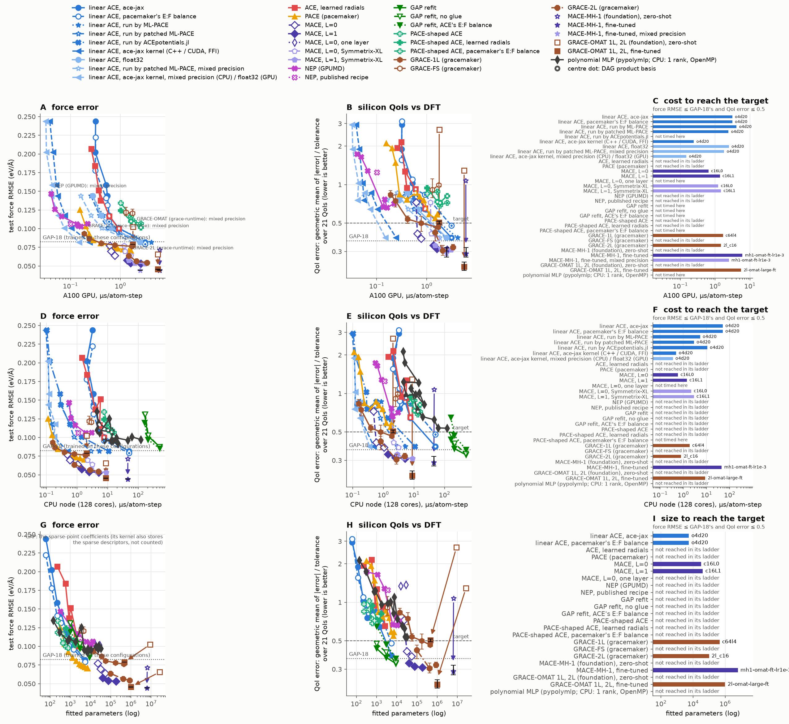

# Performance

This page gives two benchmarks:

1. **Accuracy and cost on silicon.** Fitted models of each family are
   compared at the same accuracy. The cost is the time per atom and MD step
   in LAMMPS.
2. **Speed on a five-element alloy.** Models with random weights are timed
   on the CrMnFeCoNi (Cantor) alloy. This table compares speed only, not
   accuracy.

## Accuracy and cost: silicon

All models are fitted to the same training set and tested on the same test
set. The data is the GAP-18 silicon dataset (2,475 configurations: 2,227 for
training and 248 for testing).

- **Model families.** Linear ACE (ace-jax), ACE with learned radials,
  PACE-shaped ACE, PACE (pacemaker), MACE with L = 0 and L = 1, NEP
  (trained with GPUMD), GAP refits, and GRACE-1L, GRACE-2L and GRACE-FS
  (trained with gracemaker). Each family has a ladder of model sizes. Each
  point is one fit. For GRACE and for the fine-tuned foundation models,
  each point is the mean of three fits, and the bars show the range.
- **Foundation models.** MACE-MH-1, GRACE-2L-OMAT-large and
  GRACE-1L-OMAT-large are tested as published and after fine-tuning. Refer
  to [Foundation models](#foundation-models).
- **Force error.** The root-mean-square force error on the test set.
- **QoI error.** 21 silicon properties are calculated with each model and
  compared with DFT: elastic constants, energies of other phases, point
  defects, surface and stacking-fault energies, decohesion stress and
  phonons. Each error is divided by a tolerance. The QoI error is the
  geometric mean of these values (lower is better).
- **Target.** A model reaches the target if its force error is not more than
  the force error of GAP-18, and its QoI error is not more than 0.5.
- **Cost.** Microseconds per atom per MD step, in LAMMPS, in float64. Each
  model uses the fastest code that agrees with the reference evaluation.
  NEP on the GPU, GRACE-1L and GRACE-2L are in mixed precision, because
  their fastest codes have no float64 mode.

The figure shows the force error and the QoI error of each family. The
lowest row compares the number of fitted parameters, not the cost. At
first, the figure shows only the main families. To change the families
that the figure shows:

1. Click a family in the legend to show or hide it in all panels.
2. Double-click a family to show only that family.
3. Click a button above the legend to show a group of families. The
   **Foundation models** button shows the foundation models.
4. Put the pointer on a point to show its model, its values and the code
   that was timed.

The table gives the cheapest model of each family that reaches the
target.

At the target, in microseconds per atom-step:

| model | A100 GPU | CPU node (128 cores) |
|---|---|---|
| linear ACE o4d20, ace-jax with lammps-jax (XLA program) | 3.12 | 50.5 |
| linear ACE o4d20, ace-jax kernel with lammps-jax (CUDA on the GPU, C++ on the CPU) | 0.24 | 0.49 |
| linear ACE o4d20, ace-jax kernel in reduced precision (float32 on the GPU, mixed precision on the CPU) | 0.15 | 0.35 |
| linear ACE o4d20, ML-PACE | 4.13 | 5.31 |
| linear ACE o4d20, ACEpotentials.jl | – | 10.8 |
| MACE c16L0, Symmetrix 0.3.0 | 0.65 | 0.59 |
| MACE c16L0, Symmetrix-XL | 1.23 | 2.19 |
| MACE c16L1, Symmetrix 0.3.0 | 1.37 | 1.43 |
| MACE c16L1, Symmetrix-XL | 1.47 | 2.87 |
| GRACE-1L c64l4, grace-runtime (mixed precision) | 1.68 | 1.88 |
| GRACE-2L 2l_c16, grace-runtime (mixed precision) | 1.47 | 0.81 |

On the A100, linear ACE o4d20 in the ace-jax GPU kernel has the lowest cost
at the target. It is 2.6 times faster than MACE c16L0 in Symmetrix 0.3.0.
On the CPU, these two have approximately the same cost (0.49 and 0.59
µs/atom-step). Symmetrix 0.3.0 is 3 to 4 times faster than the earlier
Symmetrix version for these MACE models.

In these ladders, PACE (pacemaker), ACE with learned radials, PACE-shaped
ACE, NEP, the GAP refits and GRACE-FS do not reach the target. GRACE-1L
reaches the target only at its largest size (c64l4, 445,793 parameters).
At that size, its cost is approximately 3 times the cost of MACE c16L0.
GRACE-2L has two message-passing layers. It reaches the target at all of
its sizes. Its smallest size (2l_c16, 98,882 parameters) costs
approximately 1.4 (CPU) to 2.3 (A100) times the cost of MACE c16L0. Linear
ACE o4d20 in the ace-jax kernel costs less on the CPU and on the A100. GRACE-2L
2l_small has a QoI error of 0.31, the same as the largest MACE L = 1 models. PACE reaches the force
error of GAP-18 with fewer parameters than linear ACE, but not the QoI target.
NEP has the lowest cost on the A100 (0.04 to 0.22 µs/atom-step), in mixed
precision. On the CPU, NEP costs 0.55 to 3.0 µs/atom-step. PACE reaches the
same force error on the CPU at a lower cost.
PACE in grace-runtime is 2.1 to 2.8 times faster than ML-PACE on the CPU.
On the A100, it has the same speed as ML-PACE up to f200, and it is 2.2
times faster at f3200. The smallest NEP force error is
0.103 eV/Å, and its smallest QoI error is 0.66.
These force errors agree with the published NEP results for this dataset
(approximately 0.1 eV/Å).

On the CPU, the ACEpotentials.jl compiled library is the fastest code for
linear ACE up to o4d14. It has the same speed as ML-PACE at o4d16. At
o4d20 it is 2 times slower than ML-PACE.

On the CPU, the ace-jax [C++ kernel](howto/lammps.md#cpu-kernel) is 18 to 100
times faster than the compiled JAX program. At o4d20 it is 11 times faster
than ML-PACE (0.49 against 5.31 µs/atom-step).

On the A100, ace-jax runs linear ACE o4d20 faster than ML-PACE (3.12
against 4.13 µs/atom-step). The ace-jax [GPU kernel](howto/lammps.md#gpu-kernel)
runs the same model at 0.24 µs/atom-step. It is the fastest linear ACE code
on the A100 for all models from o3d8 to o4d20. Against patched ML-PACE, it
is 4.6 to 9.9 times faster (o4d12 to o4d20). It is 7 to 13 times faster
than the compiled JAX program. The speed-up is largest for o4d20.

### Foundation models

A foundation model is fitted to a large dataset of many elements. The
benchmark includes three foundation models: MACE-MH-1 (its `omat_pbe`
head), GRACE-2L-OMAT-large and GRACE-1L-OMAT-large. Each model is tested in
two conditions:

- **Zero-shot.** The model is used as published. Its energies have a
  different reference from the DFT data. Thus one constant energy for each
  atom is calculated from the training set and added. The forces and the
  QoIs do not change with this constant.
- **Fine-tuned.** All parameters of the model are fitted again to the
  silicon training set of this benchmark. The loss function and the
  weights are those of the models trained from the start. Each
  point is the mean of three fits with different seeds.

In the figure, an arrow connects each zero-shot model to its fine-tuned
model.

!!! note
    The foundation models keep their architecture. Thus their cutoff
    radius is 6 Å. The cutoff radius of all other models is 5 Å.

| model | force error (eV/Å) | QoI error | A100 GPU | CPU node (128 cores) |
|---|---|---|---|---|
| MACE-MH-1, zero-shot | 0.072 | 1.08 | 6.04 | 46.0 |
| MACE-MH-1, fine-tuned | 0.044 | 0.29 (0.27 to 0.32) | 6.07 | 45.1 |
| MACE-MH-1, fine-tuned, mixed precision | 0.044 | 0.29 (0.27 to 0.32) | 2.48 | – |
| GRACE-2L-OMAT-large, zero-shot | 0.066 | 1.29 | 5.59 | 8.81 |
| GRACE-2L-OMAT-large, fine-tuned | 0.046 | 0.23 (0.21 to 0.25) | 5.60 | 8.83 |
| GRACE-1L-OMAT-large, zero-shot | 0.103 | 2.68 | 1.78 | 2.07 |
| GRACE-1L-OMAT-large, fine-tuned | 0.079 | 0.51 (0.49 to 0.52) | 1.77 | 2.08 |

The costs are in microseconds per atom-step. For the fine-tuned models,
the errors are the mean of three fits. The range of the QoI error is in
brackets. The force errors of the three fits agree to 0.001 eV/Å. The
GRACE costs are in mixed precision.

**Zero-shot.** MACE-MH-1 and GRACE-2L-OMAT-large have a smaller force
error than GAP-18 (0.083 eV/Å), although they were not fitted to this
dataset. No zero-shot model reaches the QoI target.

**Fine-tuned.** MACE-MH-1 and GRACE-2L-OMAT-large reach the target.
GRACE-2L-OMAT-large has the lowest QoI error in the figure (0.23). The QoI
error of MACE-MH-1 (0.29) is approximately that of the best models trained
from the start (0.31, GRACE-2L 2l_small and the largest MACE L = 1 models).
GRACE-1L-OMAT-large reaches the force target. Its QoI error is at the limit
of the target: one of the three fits is below 0.5.

**Cost.** Fine-tuning does not change the cost of a model. On the A100,
fine-tuned MACE-MH-1 costs 9.3 times the cost of MACE c16L0 in float64,
and 3.8 times in mixed precision. Fine-tuned GRACE-2L-OMAT-large costs 8.6
times the cost of MACE c16L0. On the CPU, MACE-MH-1 costs 76 times and
GRACE-2L-OMAT-large costs 15 times the cost of MACE c16L0.
Thus the small models trained from the start reach the target at a much
lower cost. The fine-tuned foundation models have lower errors.

### How the cost was measured

- **GPU.** One NVIDIA A100, 32,768 atoms.
- **CPU.** One node with two 64-core AMD EPYC 7742 CPUs, 4,096 atoms. All
  cores are used, with each MPI rank bound to a core. Each model uses its
  fastest layout, from 128 MPI ranks with 1 thread to 8 MPI ranks with 16
  threads. GAP uses 32 MPI ranks.
- **ace-jax** runs in LAMMPS with lammps-jax, on the GPU and on the CPU.
  ace-jax selects the form of the product basis for each model. Models with
  4,000 or more chain-form multiplications per atom use the recursive (DAG)
  form. The printed figure marks these points with a dot. In the
  interactive figure, the code line of these points shows `dag:greedy`.
- **Linear ACE, run by ML-PACE.** The same linear ACE fits are written as
  `.yace` files with tabulated radial functions
  ([Write an ACE model as a .yace file](howto/pace.md)). They run in
  `pair_style pace` (CPU) and `pair_style pace/kk` (GPU).
- **Linear ACE, run by ACEpotentials.jl.** The same linear ACE fits are
  converted to ACEpotentials.jl models. Each model is compiled to a shared
  library with `juliac --trim` and runs in LAMMPS with the ACEpotentials.jl
  `pair_style ace` plugin. These results are for the CPU only, with 128 MPI
  ranks.
- **ace-jax kernel.** The same ace-jax bundles, with a kernel in place of
  the compiled JAX program. On the CPU, the
  [C++ kernel](howto/lammps.md#cpu-kernel) runs with 128 MPI ranks and one
  thread for each rank. On the A100, the
  [GPU kernel](howto/lammps.md#gpu-kernel) runs with one MPI rank.
- **ace-jax kernel in reduced precision.** The light-blue line with
  triangles is the same kernel with less precision. On the CPU, it uses
  [mixed precision](howto/precision.md#mixed-precision-for-the-kernels). The
  CPU line starts at o3d10: for o3d8, the energy error of mixed precision
  (0.6 meV for each atom) is more than the limit of the benchmark. Below
  o4d14, mixed precision is not faster than float64. On the A100, it runs
  float32 bundles. The accuracy that
  the figure shows is that of the float64 fit. These results are not
  included in the comparison with the float64 results of the other codes.
- **ML-PACE** on the GPU is the LAMMPS development version with the 2026
  `pace/kk` GPU update.
- **MACE** runs in LAMMPS with Symmetrix 0.3.0 (`pair_style
  symmetrix/mace`) and, separately, with Symmetrix-XL. Symmetrix does not
  support the one-layer MACE models.
- **PACE (pacemaker)** runs in LAMMPS with `pair_style pace/runtime` from
  ICAMS grace-runtime 0.1.4, in float64. It reads the B-basis `.yaml` file
  of pacemaker. Its radial functions are tables with 1,024 intervals.
- **GAP** runs in LAMMPS with QUIP, on the CPU only.
- **GRACE-1L and GRACE-2L** run in LAMMPS with `pair_style
  grace/runtime` (CPU) and `grace/runtime/kk` (GPU) from ICAMS
  grace-runtime 0.1.4. grace-runtime calculates the neural network in
  float32 and the geometry and the sums in float64. The figure labels
  these points as mixed precision. They are 24 to 39 times faster on the
  CPU, and 6 to 16 times faster on the A100, than the float64 Kokkos
  styles of gracemaker's LAMMPS version.
- **GRACE-FS** runs in LAMMPS with `grace/fs/kk` (GPU) and `grace/fs`
  (CPU), in float64. grace-runtime does not support GRACE-FS.
- **MACE-MH-1** runs in LAMMPS with `pair_style
  symmetrix/mace/foundation` from Symmetrix 0.3.0, in float64. The
  mixed-precision result uses `symmetrix/mace/foundation/float32-mixed`,
  which runs on the GPU only.
- **GRACE-OMAT** runs in LAMMPS with the same grace-runtime styles as
  GRACE-1L and GRACE-2L, in mixed precision. On the CPU, GRACE-2L-OMAT-large
  does not have sufficient memory with 128 MPI ranks. It uses 8 MPI ranks
  with 16 threads.
- **The foundation models on the A100** were timed on nodes that other
  jobs used at the same time. All other models were timed on nodes with
  no other jobs.
- **NEP** is trained with GPUMD. On the CPU, it runs in LAMMPS with
  `pair_style nep` (NEP_CPU, float64). On the GPU, it runs in GPUMD. GPUMD
  uses mixed precision, and the figure labels these points.
- **Before each timing**, a short check compares the energies and forces
  in LAMMPS with the reference evaluation of the same model.

!!! note
    ML-PACE reads tabulated radial functions only with an addition that is
    not yet in its releases
    ([ML-PACE pull request 31](https://github.com/ICAMS/lammps-user-pace/pull/31)).
    The "linear ACE, run by ML-PACE" results use a build of ML-PACE with
    that addition.

### How the QoI error was calculated

- The reference is DFT (CASTEP), as for the training data.
- Each normalised error is limited to the range 0.05 to 10 before the
  geometric mean. Thus one very large or very small error does not control
  the result.
- The energy of compressed hcp silicon is not included. These structures
  are outside the training data, so the error measures extrapolation.
- Only models with all 21 QoIs calculated are shown.
- MACE with one layer, and Symmetrix MACE c64L1 on the GPU, have float32
  timings only. They are not in the cost rows.
- The GAP parameter count includes only the sparse-point coefficients. The
  GAP kernel also keeps the sparse descriptors.

## Speed: a five-element alloy

The silicon benchmark has one element. This table shows the cost for a
system with five elements: the equiatomic CrMnFeCoNi (Cantor) alloy on an fcc
lattice. The cost is in microseconds per atom-step (lower is better), in
LAMMPS and in float64.

--8<-- "benchmarks-cantor.md"

- **Models.** The models have **random weights**. Their cost is the same as
  the cost of a fitted model of the same size, but they do not predict
  correctly. Thus this table compares only speed.
    - The linear ACE model has 447 basis functions for each element.
    - The PACE model has 496 basis functions for each element. ace-jax and
      ML-PACE evaluate the same `.yace` file.
    - The MACE model is MACE-MP-0b2 medium.
- **Codes.** The LAMMPS builds are those of the silicon benchmark: ace-jax
  with lammps-jax, ML-PACE as `pair_style pace` and `pair_style pace/kk`,
  and MACE with Symmetrix v0.3.0.
- **ace-jax kernel.** The kernel evaluates linear ACE models only. Thus the
  PACE model runs as the compiled JAX program.
- **GPU.** One NVIDIA A100, 32,768 atoms, one MPI rank.
- **CPU.** One node with two 64-core AMD EPYC 7742 CPUs, 8,192 atoms, 128
  MPI ranks with one thread for each rank.
- **Parity.** Before the timing, each code in LAMMPS is compared with its
  own reference evaluator on three cells of 256 atoms. All codes agree with
  their references.

The results are:

- On the linear ACE model, the ace-jax kernel is 3.9 times faster than the
  compiled JAX program on the A100. On the CPU, it is 10 times faster.
- The ace-jax kernel on the linear ACE model costs less than ML-PACE on the
  PACE model: 0.15 against 0.30 µs/atom-step on the A100, and 0.38 against
  0.51 on the CPU. These are different models of approximately the same
  size.
- On the same PACE model, ML-PACE is 2.4 times faster than ace-jax on the
  A100. On the CPU, it is 11 times faster.
- MACE-MP-0b2 medium costs 7.5 µs/atom-step on the A100 and 29 on the CPU.
  This is 50 and 78 times the cost of the ace-jax kernel on the linear ACE
  model.

!!! warning
    The CPU row uses 128 MPI ranks with one thread for all codes. The
    silicon benchmark uses the fastest layout of each model. Thus a code can
    be faster on the CPU with a different layout. The cost of MACE on the
    CPU changed by more than 20% between 1,024 and 8,192 atoms.

## More

- [Full results of both benchmarks](https://github.com/ACEsuit/ace-jax/blob/main/docs/dev/accuracy-cost-results.md):
  every model, the parity checks, the versions and the commands.
