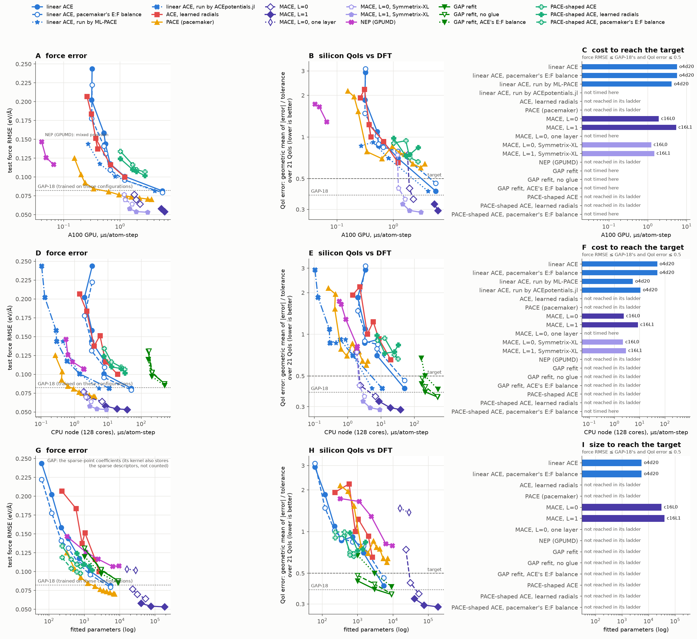
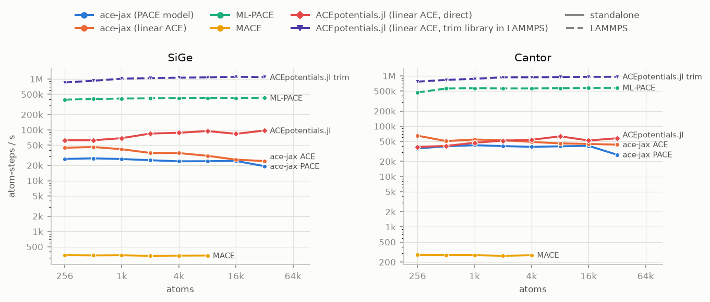
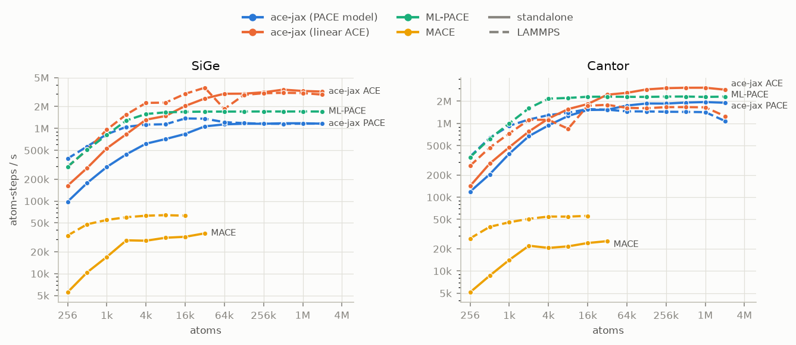
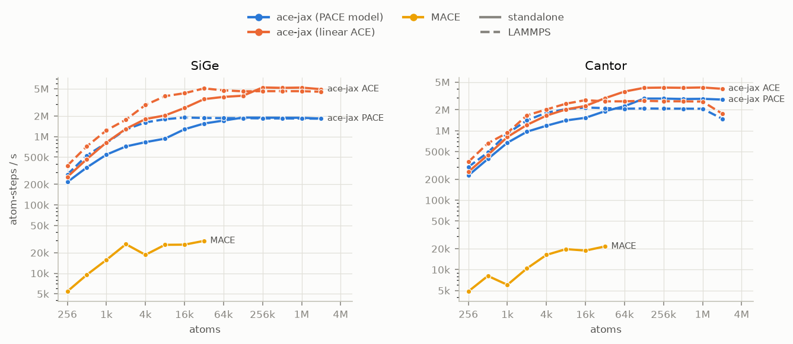

# Performance

This page gives two benchmarks:

1. **Accuracy and cost on silicon.** Fitted models of each family are
   compared at the same accuracy. The cost is the time per atom and MD step
   in LAMMPS.
2. **Speed on SiGe and Cantor.** Models with random weights are compared at
   the same size. These figures compare speed only, not accuracy.

## Accuracy and cost: silicon

All models are fitted to the same training set and tested on the same test
set. The data is the GAP-18 silicon dataset (2,475 configurations: 2,227 for
training and 248 for testing).

- **Model families.** Linear ACE (ace-jax), ACE with learned radials,
  PACE-shaped ACE, PACE (pacemaker), MACE with L = 0 and L = 1, NEP
  (trained with GPUMD), GAP refits, and GRACE-1L and GRACE-FS (trained
  with gracemaker). Each family has a ladder of model sizes. Each point is
  one fit. For GRACE, each point is the mean of three fits, and the bars
  show the range.
- **Force error.** The root-mean-square force error on the test set.
- **QoI error.** 21 silicon properties are calculated with each model and
  compared with DFT: elastic constants, energies of other phases, point
  defects, surface and stacking-fault energies, decohesion stress and
  phonons. Each error is divided by a tolerance. The QoI error is the
  geometric mean of these values (lower is better).
- **Target.** A model reaches the target if its force error is not more than
  the force error of GAP-18, and its QoI error is not more than 0.5.
- **Cost.** Microseconds per atom per MD step, in LAMMPS, in float64. Each
  model uses the fastest code that agrees with the reference evaluation.

The figure shows the force error and the QoI error of each family. The
lowest row compares the number of fitted parameters, not the cost. At
first, the figure shows only the main families. To change the families
that the figure shows:

1. Click a family in the legend to show or hide it in all panels.
2. Double-click a family to show only that family.
3. Click a button above the legend to show a group of families.
4. Put the pointer on a point to show its model, its values and the code
   that was timed.

The table gives the cheapest model of each family that reaches the
target.

At the target, in microseconds per atom-step:

| model | A100 GPU | CPU node (128 cores) |
|---|---|---|
| linear ACE o4d20, ace-jax with lammps-jax (XLA program) | 3.12 | 50.5 |
| linear ACE o4d20, ace-jax with lammps-jax and cuequivariance | 1.61 | – |
| linear ACE o4d20, ace-jax C++ kernel with lammps-jax | – | 3.29 |
| linear ACE o4d20, ML-PACE | 4.13 | 5.31 |
| linear ACE o4d20, ACEpotentials.jl | – | 10.8 |
| MACE c16L0, Symmetrix | 1.93 | 2.36 |
| MACE c16L0, Symmetrix-XL | 1.23 | 2.19 |
| MACE c16L1, Symmetrix | 5.36 | 8.58 |
| MACE c16L1, Symmetrix-XL | 1.47 | 2.87 |
| GRACE-1L c64l4, `grace/1l/kk` | 11.65 | 59.1 |

In these ladders, PACE (pacemaker), ACE with learned radials, PACE-shaped
ACE, NEP, the GAP refits and GRACE-FS do not reach the target. GRACE-1L
reaches the target only at its largest size (c64l4, 445,793 parameters).
At that size, its cost is approximately 4 to 27 times the cost of linear
ACE o4d20 or MACE c16L0 in their fastest codes. PACE reaches the force
error of GAP-18 with fewer parameters than linear ACE, but not the QoI target.
NEP has the lowest cost on the A100 (0.04 to 0.22 µs/atom-step), in mixed
precision. On the CPU, NEP costs 0.55 to 3.0 µs/atom-step. PACE reaches the
same force error on the CPU at a lower cost. The smallest NEP force error is
0.103 eV/Å, and its smallest QoI error is 0.66.
These force errors agree with the published NEP results for this dataset
(approximately 0.1 eV/Å).

On the CPU, the ACEpotentials.jl compiled library is the fastest code for
linear ACE up to o4d14. It has the same speed as ML-PACE at o4d16. At
o4d20 it is 2 times slower than ML-PACE.

On the CPU, the ace-jax [C++ kernel](howto/lammps.md#cpu-kernel) is 10 to 23
times faster than the compiled JAX program on the same node. At o4d20 it is
1.6 times faster than ML-PACE (3.29 against 5.31 µs/atom-step).

On the A100, ace-jax runs linear ACE o4d20 faster than ML-PACE (3.12
against 4.13 µs/atom-step). With the cuequivariance product basis, ace-jax
runs the same model at 1.61 µs/atom-step. For o4d20, this is the fastest
linear ACE code on the A100. For o4d12 to o4d16, patched ML-PACE is faster.
From o3d12 to o4d20, cuequivariance is 1.2 to 1.9 times
faster than the default product basis. For o3d8 and o3d10, the two forms
have approximately the same cost.

### How the cost was measured

- **GPU.** One NVIDIA A100, 32,768 atoms.
- **CPU.** One node with two 64-core AMD EPYC 7742 CPUs, 4,096 atoms. All
  cores are used, with each MPI rank bound to a core. Each model uses its
  faster layout: 128 MPI ranks, or 64 MPI ranks with 2 threads. GAP uses 32
  MPI ranks.
- **ace-jax** runs in LAMMPS with lammps-jax, on the GPU and on the CPU.
  ace-jax selects the form of the product basis for each model. Models with
  4,000 or more chain-form multiplications per atom use the recursive (DAG)
  form. The printed figure marks these points with a dot. In the
  interactive figure, the code line of these points shows `dag:greedy`.
- **ace-jax with cuequivariance.** The same linear ACE fits run in
  lammps-jax bundles with `aa_dag="cueq"`, on the A100 only
  ([cuequivariance on the GPU](howto/lammps.md#cuequivariance-on-the-gpu)).
  Each model is exported one time, for 32,768 atoms. The check and the
  timed runs use that bundle.
- **Linear ACE, run by ML-PACE.** The same linear ACE fits are written as
  `.yace` files with tabulated radial functions
  ([Write an ACE model as a .yace file](howto/pace.md)). They run in
  `pair_style pace` (CPU) and `pair_style pace/kk` (GPU).
- **Linear ACE, run by ACEpotentials.jl.** The same linear ACE fits are
  converted to ACEpotentials.jl models. Each model is compiled to a shared
  library with `juliac --trim` and runs in LAMMPS with the ACEpotentials.jl
  `pair_style ace` plugin. These results are for the CPU only, with 128 MPI
  ranks.
- **ace-jax C++ kernel.** The same ace-jax bundles, with the
  [C++ kernel](howto/lammps.md#cpu-kernel) in place of the compiled JAX
  program. These results are for the CPU only, with 128 MPI ranks. The
  kernel uses one thread for each rank.
- **ML-PACE** on the GPU is the LAMMPS development version with the 2026
  `pace/kk` GPU update.
- **MACE** runs in LAMMPS with Symmetrix and, separately, with
  Symmetrix-XL.
- **GAP** runs in LAMMPS with QUIP, on the CPU only.
- **GRACE** runs in LAMMPS with the native Kokkos styles of gracemaker's
  LAMMPS version: `grace/1l/kk` (GPU) and `grace/1l/cpu/kk` (CPU) for
  GRACE-1L, `grace/fs/kk` and `grace/fs` for GRACE-FS, in float64. On the
  CPU, GRACE uses 128 MPI ranks.
- **NEP** is trained with GPUMD. On the CPU, it runs in LAMMPS with
  `pair_style nep` (NEP_CPU, float64). On the GPU, it runs in GPUMD. GPUMD
  uses mixed precision, and the figure labels these points.
- **Before each timing**, a short check compares the energies and forces
  in LAMMPS with the reference evaluation of the same model.

!!! note
    ML-PACE reads tabulated radial functions only with an addition that is
    not yet in its releases
    ([ML-PACE pull request 31](https://github.com/ICAMS/lammps-user-pace/pull/31)).
    The "linear ACE, run by ML-PACE" results use a build of ML-PACE with
    that addition.

### How the QoI error was calculated

- The reference is DFT (CASTEP), as for the training data.
- Each normalised error is limited to the range 0.05 to 10 before the
  geometric mean. Thus one very large or very small error does not control
  the result.
- The energy of compressed hcp silicon is not included. These structures
  are outside the training data, so the error measures extrapolation.
- Only models with all 21 QoIs calculated are shown.
- MACE with one layer, and Symmetrix MACE c64L1 on the GPU, have float32
  timings only. They are not in the cost rows.
- The GAP parameter count includes only the sparse-point coefficients. The
  GAP kernel also keeps the sparse descriptors.

## Speed: SiGe and Cantor

Each figure shows the throughput against the system size. The throughput is
in **atom-steps per second** (atoms × evaluations per second; higher is
better).

- **Workload.** The workload is similar to MD. Before each timed evaluation
  of energy and forces, each atom moves a small distance, as between two
  MD steps. The compilation time is not included.
- **Models.** The models are **medium-size models with random weights**.
  Their cost is the same as the cost of a fitted model, but they do not
  predict correctly:
    - PACE `.yace` models of approximately 500 basis functions for each
      element (ace-jax and ML-PACE evaluate the same files);
    - linear ACE models of approximately 450 basis functions for each
      element;
    - MACE-MP-0b2 medium.
- **Standalone** (solid lines) is a direct call of the evaluator, outside an
  MD engine. For ace-jax and MACE, this is one ASE calculator call from
  Python, including the neighbour list.
- **LAMMPS** (dashed lines) is the time of one MD step in LAMMPS: ace-jax
  with lammps-jax ([LAMMPS export](howto/lammps.md)), ML-PACE as
  `pair_style pace`, MACE with Symmetrix.
- **Systems.** SiGe, a random alloy on diamond, and Cantor, the equiatomic
  CrMnFeCoNi alloy on fcc.

### CPU, float64

When these figures were made, lammps-jax supported only GPUs. Thus the CPU
figure shows ace-jax standalone only. The silicon benchmark above includes
ace-jax in LAMMPS on the CPU.

### GPU, float64

### GPU, float32

### At 8,192 atoms

Atom-steps per second at 8,192 atoms. "—" shows that a code does not run
in that setting, or ran out of memory at a smaller size.

--8<-- "benchmarks-table.md"

## Caveats

--8<-- "benchmarks-notes.md"
- Random weights set the cost of a model, not its accuracy. Thus these
  numbers compare only speed. A fitted model of the same size has the same
  speed.
- ace-jax standalone uses its neighbour list again while the atoms stay in
  the skin. MACE standalone builds the list again at each call.
- The throughput depends on the model size, the cutoff and the number of
  neighbours. The [full benchmarks](https://github.com/ACEsuit/ace-jax/blob/main/docs/dev/benchmarks.md)
  include small and large models, peak memory and the largest system that
  fits in memory.

## More

- [Full benchmark results](https://github.com/ACEsuit/ace-jax/blob/main/docs/dev/benchmarks.md):
  every model size and host, memory, precision, parity checks and versions.
- [How to rerun the benchmarks](https://github.com/ACEsuit/ace-jax/blob/main/bench/scaling/README.md).
