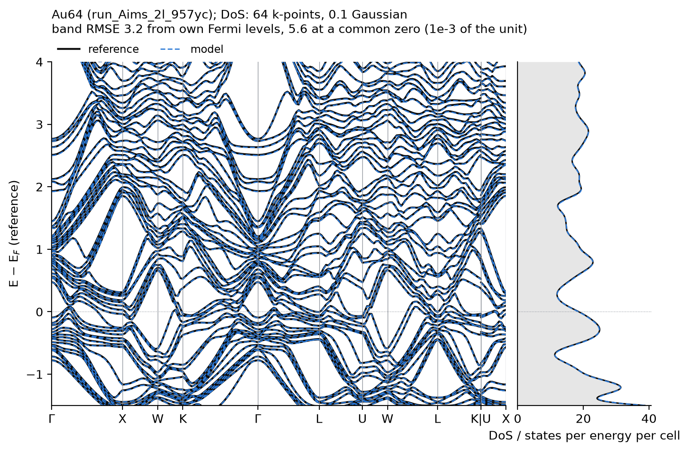
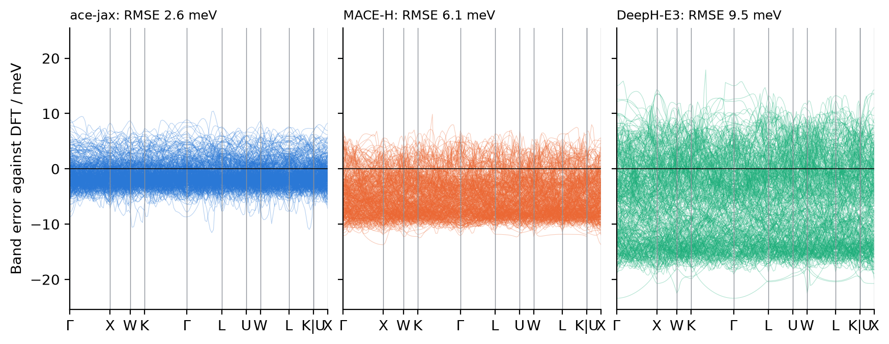

# Hamiltonian models

A Hamiltonian model predicts the Hamiltonian matrix H and the overlap matrix S
of a structure in a basis of atomic orbitals. The bands, the density of states
and the band energy come from these matrices without a self-consistent
calculation.

ace-jax fits the model to the matrices of DFT calculations. The fit is a linear
least-squares problem. It has no training loop and needs only a few structures.

!!! warning
    Hamiltonian models are new. The command names, the options and the model
    file can change in the next releases.

--8<-- "float64.md"

## Install

1. Add `ham` to the extras that you install: `pip install "ace-jax[ham]"`.

The `ham` extra installs h5py, which reads and writes the DeepH file layout.

## The data

The training data is a set of structures with blocks. A block is the part of H
or S that connects the orbitals of one atom with the orbitals of a second atom.
An on-site block connects an atom with itself. An off-site block connects two
different atoms, or an atom and its periodic image.

`aj ham` reads a directory that contains one of these:

- subdirectories in the DeepH layout, one for each structure
  (`hamiltonians.h5`, `overlaps.h5` and the structure files);
- operator cache files (`*.npz`), one for each structure, written by
  `ace_jax.ham.cache.save`.

All structures of a dataset must have the same orbital basis. For FHI-aims
output, [Quoll.jl](https://github.com/maurergroup/Quoll.jl) writes the DeepH
layout.

A DeepH subdirectory with `up` and `dn` inside is a collinear-spin structure.
Its channels are `H_up`, `H_dn` and `S`.

## Fit a model

1. Put the training structures in one directory and the validation set in a
   second directory.
2. Run the fit.
3. Read the errors on the validation set.

```bash
aj ham fit --data train/ --validation validation/ --out gold.npz \
    --nelectrons 79:11 --kpts 4 4 4
```

The command prints the training residual, then the errors of the model on the
validation set, and writes the model file. The model file contains the basis,
the coefficients and a record of the fit.

`--nelectrons` gives the number of electrons that the bands contain. Give one
number for the cell, or `Z:n` pairs for the electrons of each atom of each
element. The default is the atomic number, which is correct for an
all-electron basis.

The model file records the `--nelectrons` of the fit. `aj eval`,
`aj ham predict` and `aj ham bands` use this value if you do not give the
option.

### The basis

The default basis is accurate for a metal with s, p and d orbitals. Change it
with these options:

| Option | Meaning |
|---|---|
| `--site-rcut`, `--site-radials` | cutoff and number of radial functions of the environment of each atom |
| `--bond-radials` | number of radial functions of the distance between the two atoms of a block |
| `--bond-rcut` | longest distance that has a block. The default is the longest distance in the data |
| `--coupled N L` | features that couple the bond with the environments of its two atoms |
| `--env R N L NB LB` | features of the atoms near the bond. This group gives most of the accuracy and most of the cost. The default is `5 8 4 6 4` |
| `--no-env` | no features of the atoms near the bond. The model is fast and less accurate |

`--env 5 6 4 4 4` is a smaller basis. It was the default to version 0.7.2. The fit and the
prediction are approximately 1.2 to 2 times faster, and the band error is larger: 1.5 times
on bulk gold and 2.7 times on bulk aluminium, each with approximately 32 training structures.

### The prior

`--prior` sets a smoothness prior on the coefficients.

- `none` (the default) fits with no prior. Use it when the data is from one
  material and the structures are similar.
- `evidence` selects the prior scale by the Bayesian evidence. Use it for
  datasets with many elements.
- `loo` selects the prior scale by leaving one structure out at a time. On a
  dataset with four elements it did not remove the problem in the warning
  below, and its fit used much more time and disk space.
- A number sets the scale directly.

`--noise-floor` sets the smallest noise of H that `--prior evidence` can
select, in the unit of the data. A good value is the difference of H between
two SCF calculations of the same structure. For FHI-aims with
`sc_accuracy_rho 1e-5`, this difference is approximately 1e-7 eV for off-site
blocks and 3e-6 eV for on-site blocks.

`--data-memory` sets the memory for the blocks of the training structures, in
GB. The default is 8. The fit reads a larger dataset from disk again for each
of its four passes. The memory of the fit then does not increase with the
number of structures.

!!! warning
    A fit with no prior can give an eigenvalue far from the bands when the
    overlap matrix is almost singular. The block errors do not show this
    problem. If the validation set shows a structure with a large band error,
    fit again with `--prior evidence`.

## Read the errors

`aj ham fit --validation` and `aj eval --model gold.npz --data validation/`
print the same tables.

For a model without an overlap, the eigenvalues of the model and of the
reference are both calculated with the overlap of the reference structures.
If the structures have no overlap, the two spectra use S = 1.

- **Blocks**: the error of the matrix elements, for the on-site and the
  off-site blocks of each channel.
- **Bands at a common zero**: the eigenvalue error with the two spectra as
  they are.
- **Bands from own Fermi levels**: the eigenvalue error after each spectrum is
  moved to its own Fermi level. Most publications give this number.
- **Fermi level** and **band energy for each atom**: the errors of these two
  quantities.
- **Density of states**: the Wasserstein distance between the two densities
  of states. It is the mean distance that the states must move.

The eigenvalue errors include the states from `--window LO HI` relative to the
reference Fermi level. The summary names each structure with a band error
larger than 5 times the median.

Energies are in the unit of the data. For FHI-aims data the unit is eV, and the
tables show meV.

## Predict H and S

1. Give the model file and the structures: an extxyz file, or a directory of
   structures with blocks.

```bash
aj ham predict --model gold.npz --data structures.xyz --out predicted/
```

The command writes one subdirectory in the DeepH layout for each structure,
with `hamiltonians_pred.h5` and `overlaps_pred.h5`.

## Bands and density of states

1. Give the model file and one structure.

```bash
aj ham bands --model gold.npz --structure validation/ --index 0 \
    --out bands.npz --plot bands.png
```

The command calculates the bands on the high-symmetry path of the cell and the
density of states on the `--kpts` grid. `--path` sets a different path, for
example `GXMG`.

If the structure has blocks, the command also calculates the bands of the
reference and prints the errors of the model. The figure then shows the two
sets of bands together. `--plot` needs matplotlib.

## Example: bulk gold

This example uses the bulk gold dataset of the MACE-H publication
([Zenodo 10.5281/zenodo.15223696](https://doi.org/10.5281/zenodo.15223696)).
The dataset has 64-atom cells from FHI-aims with 9 orbitals for each atom, in
the DeepH layout. The fit uses 32 training structures. The validation set is
the 10 test structures of the dataset.

1. Fit the model with the default basis.

    ```bash
    aj ham fit --data train/ --validation test/ --out gold.npz \
        --nelectrons 79:11 --kpts 4 4 4
    ```

2. Draw the bands and the density of states of one test structure.

    ```bash
    aj ham bands --model gold.npz --structure test/ --index 0 --kpts 4 4 4 \
        --plot-window -1.5 4 --plot gold_bands.png
    ```

The fit takes approximately 70 seconds on one GPU. On the validation set the
band error from own Fermi levels is 2.1 meV, and the off-site blocks of H have
a mean absolute error of 0.28 meV.



The figure shows the bands of the model on the bands of the DFT reference.
The cell has 64 atoms, thus the bands are folded. Below −1.5 eV the d bands
are too dense for a figure of this size. The density of states and the errors
that the command prints include these bands.

### Comparison with MACE-H and DeepH-E3

The table compares ace-jax with MACE-H and DeepH-E3. Each code used the same
32 training structures, and the same program calculated the errors on the same
10 test structures. The two networks have the configuration that the MACE-H
authors published for this dataset. Their training was on one A100 GPU.

| Model | H error (MAE) | Band error (RMSE, own Fermi levels) | Prediction on one CPU core | Prediction on a GPU | Fit or training time |
|---|---|---|---|---|---|
| ace-jax, default basis | 0.29 meV | 2.1 meV | 14 ms for each atom | 0.6 ms for each atom | 70 s |
| ace-jax, largest basis of the benchmark | 0.13 meV | 1.3 meV | 18 ms | 0.6 ms | approximately 7 minutes |
| MACE-H | 0.38 meV | 5.3 meV | 258 ms | 3.5 ms | more than 14 hours |
| DeepH-E3 | 0.47 meV | 8.4 meV | 264 ms | 3.6 ms | 12.5 hours |

The prediction times are for the blocks of H only. They do not include the
calculation of the eigenvalues. The CPU is one core of a Xeon Gold 6130. The
GPU is an RTX 4000 Ada in float32. ace-jax on the CPU is in float64.

!!! note
    The MACE-H training with 32 structures stopped at its time limit of
    14 hours. The table shows its best model at that time. With 16 structures
    its training was complete, and its band error was 6.1 meV. A MACE-H network
    of half the size, with 32 structures and complete training, has a band error
    of 4.6 meV and a prediction time of 126 ms for each atom on one CPU core.

The next figure shows the error of each band on the path, for the test
structure of the first figure.



For each code, the mean of the errors is not zero. This is a shift of all the
eigenvalues of a structure together, through the error of the Fermi level.
The shift is different for each structure. It does not change the shape of the
bands, but it changes the band energy.

## Use the model from Python

`HamiltonianCalculator` is an ASE calculator.

```python
import jax
jax.config.update("jax_enable_x64", True)

from ace_jax.ham.calculator import HamiltonianCalculator

calc = HamiltonianCalculator("gold.npz", kpts=(4, 4, 4), nelectrons={79: 11}, width=0.1)
atoms.calc = calc
atoms.get_forces()
calc.get_eigenvalues(kpt=0)
calc.get_fermi_level()
H = calc.get_hamiltonian(atoms)      # {(Rx, Ry, Rz, i, j): block}
calc.write_results("predicted")      # DeepH layout
```

!!! warning
    The energy of this calculator is the band energy. It is not a total
    energy: it has no repulsive term. The forces and the stress are the
    derivatives of the band free energy only.

`threads=` sets the number of CPU threads for the off-site blocks.
